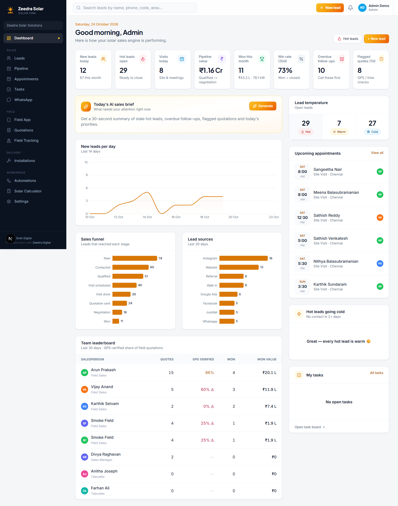
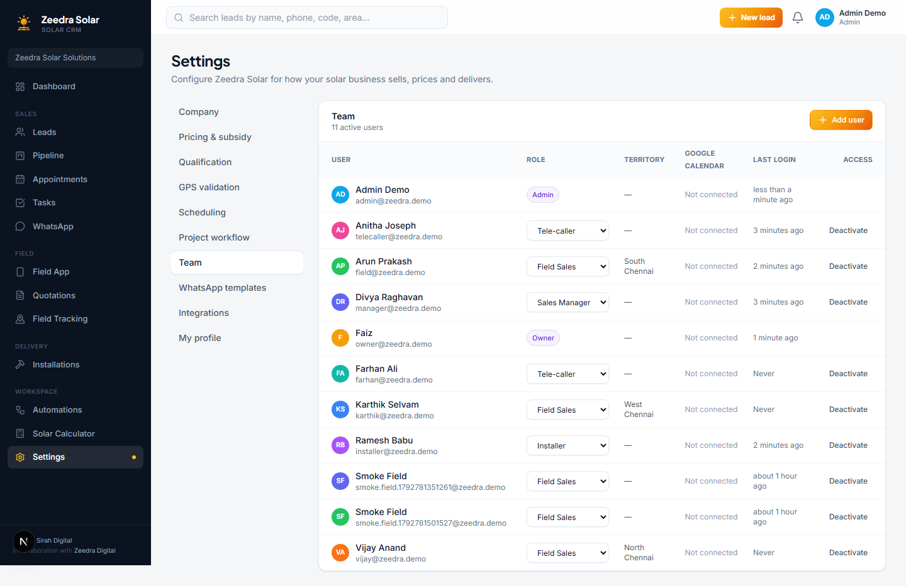

# Zeedra Solar CRM: Admin Guide

This guide is for an Admin. Admin has almost the same access as the Owner: every lead, every quotation, every installation, the full team list, and every Settings tab except one.

The only difference between Admin and Owner is **Billing & plan**. That tab only shows up for the Owner. Everything else below works exactly the same way for you.

Because the two roles share the same screens, this guide reuses the Owner's screenshots for anything that looks identical, and only shows a fresh screenshot where something is actually different.

If you only need a quick refresher while you work, open **Help & guide** from the left sidebar inside the app.

## Contents

1. [Signing in](#signing-in)
2. [Dashboard](#dashboard)
3. [Leads, Pipeline, Appointments and Tasks](#leads-pipeline-appointments-and-tasks)
4. [WhatsApp](#whatsapp)
5. [Field App](#field-app)
6. [Quotations](#quotations)
7. [Field Tracking](#field-tracking)
8. [Installations](#installations)
9. [Automations](#automations)
10. [Solar Calculator](#solar-calculator)
11. [Settings](#settings)

---

## Signing in

Go to the sign-in page and enter your email and password. Click **Sign in**.

### Your first week

1. Go to **Settings → Team** and check everyone who should have access is there, with the right role.
2. Check **Settings → Company**, **Pricing & subsidy** and **WhatsApp templates** so quotes and messages carry the business's real numbers and tone.
3. Step into **Leads**, **Quotations** or **Installations** whenever you need to help a deal move forward.

---

## Dashboard

The Dashboard is your home screen. It shows new leads, hot leads still open, visits scheduled today, pipeline value, this month's wins, and anything overdue. As Admin you also see the AI sales brief and the team leaderboard, the same as the Owner does.

Click any stat tile to jump to that filtered list. See the [Owner guide's Dashboard section](owner.md#dashboard) for the full walkthrough. It is identical for you.

---

## Leads, Pipeline, Appointments and Tasks

These work exactly as described in the Owner guide:

- [Leads](owner.md#leads), including adding a new lead, the AI co-pilot, and booking a visit.
- [Pipeline](owner.md#pipeline), the drag-and-drop stage board.
- [Appointments](owner.md#appointments), the team's visit calendar.
- [Tasks](owner.md#tasks), your follow-up to-do list, with the option to view the whole team's tasks.

As Admin, you see every lead in the organisation, the same as the Owner.

---

## WhatsApp

A single inbox for every WhatsApp conversation with every lead, automated and manual. See [Owner guide: WhatsApp](owner.md#whatsapp) for the full walkthrough.

---

## Field App

Available to you the same as it is to the Owner and Sales Managers, since all three roles can create quotations. See [Owner guide: Field App](owner.md#field-app).

---

## Quotations

Every solar proposal your team has created. You can see and review all of them, including flagged ones that could not be confirmed as created at the customer's site. See [Owner guide: Quotations](owner.md#quotations).

---

## Field Tracking

A live map of your field sales team. See [Owner guide: Field Tracking](owner.md#field-tracking).

---

## Installations

Every project your business has won, tracked from booking through to subsidy credit. See [Owner guide: Installations](owner.md#installations).

---

## Automations

Your sales playbook on autopilot. See [Owner guide: Automations](owner.md#automations).

---

## Solar Calculator

A quick calculator for live calls. See [Owner guide: Solar Calculator](owner.md#solar-calculator).

---

## Settings

You see the same tabs as the Owner, with one exception.

Notice there is no **Billing & plan** tab in your settings menu. That is the only tab reserved for the Owner. Everything else, Company, Pricing & subsidy, Qualification, GPS validation, Scheduling, Project workflow, Team, WhatsApp templates, Integrations and My profile, works exactly as described in the [Owner guide's Settings section](owner.md#settings).

---

That covers everything you can do as Admin. If you ever need a reminder while you work, the **Help & guide** page inside the app has the same content, filtered to whatever you are signed in as.
