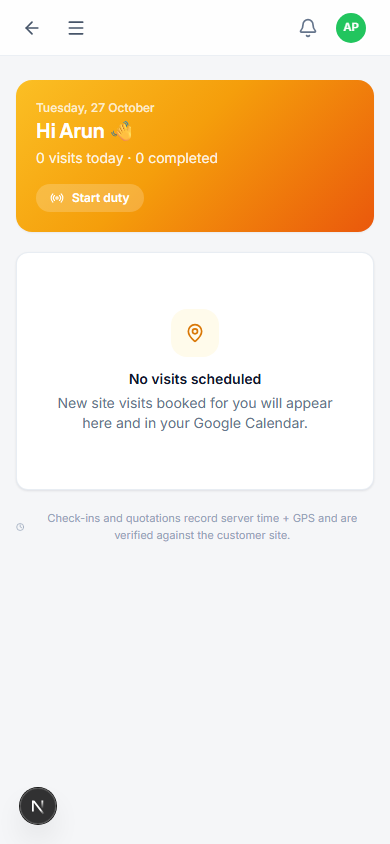
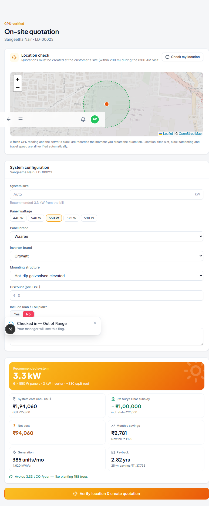
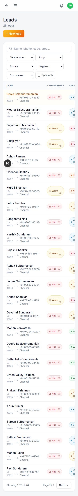
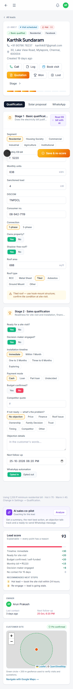
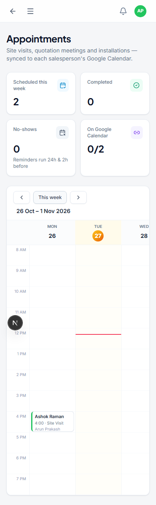
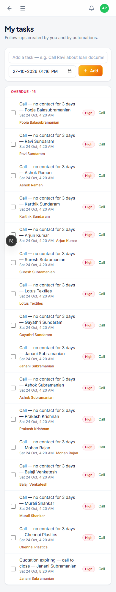
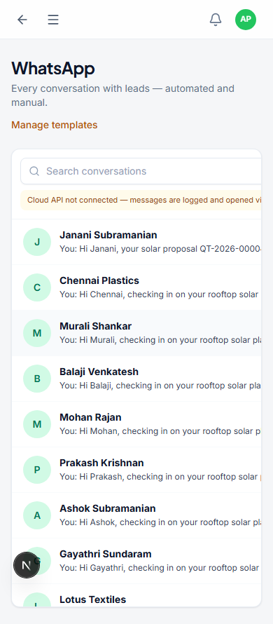
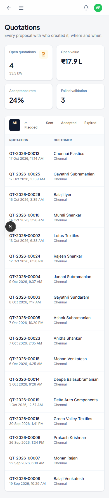
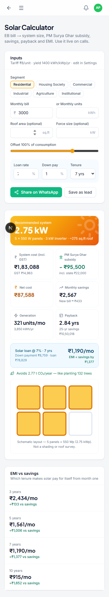

# Zeedra Solar CRM: Field Sales Guide

This guide is for a Field Sales rep. You meet customers at their homes or offices, so most of your work happens in the **Field App**, which is built for your phone. You only see leads and appointments assigned to you.

If you only need a quick refresher while you work, open **Help & guide** from the menu in the app.

## Contents

1. [Signing in](#signing-in)
2. [Field App](#field-app)
3. [Checking in and building a quote on site](#checking-in-and-building-a-quote-on-site)
4. [My Leads](#my-leads)
5. [Appointments](#appointments)
6. [Tasks](#tasks)
7. [WhatsApp](#whatsapp)
8. [Quotations](#quotations)
9. [Solar Calculator](#solar-calculator)

---

## Signing in

Go to the sign-in page on your phone and enter your email and password. Click **Sign in**. You will land straight on the Field App, since that is where your work happens.

### Your typical day

1. Open the Field App and tap **Start duty** so your manager can see you are out and about.
2. For each visit: tap **Navigate** for directions, then **Check in** once you arrive at the customer's site.
3. After checking in, tap **Quote** to build the solar proposal on the spot.
4. When the visit is done, tap **Complete** and record the outcome.

---

## Field App

The Field App lists your visits for today, tomorrow and later as simple cards you can act on with your thumb.

Tap **Start duty** at the top of the screen when you begin your day. This shares your location with the office every few minutes while you are on duty, which is also what powers the Field Tracking map your manager uses.

For each visit card, you have four actions:

- **Navigate**: opens Google Maps with directions to the customer.
- **Call**: rings the customer directly.
- **Check in**: records your GPS location at the moment you arrive. Do this before anything else at the site.
- **Complete**: opens a form to record the outcome of the visit once you are done.

---

## Checking in and building a quote on site

Always check in first. Once you are checked in, the **Quote** button appears on that visit's card. Tap it to open the on-site quotation builder for that customer.

The page shows your current location on a map, with a dashed circle around the customer's address. It records a fresh GPS reading and the server's clock the moment you create the quotation. This is what protects you: if you really are at the customer's site, the system can prove it, and the quote will not get flagged.

Fill in the system details:

- **Panel wattage**, **panel brand**, **inverter brand** and **mounting structure**. Sensible defaults are already selected, so you only need to change what is different for this customer.
- A **discount**, if your manager has approved one.
- Whether to **include a loan or EMI plan** in the proposal.

As you fill the form in, the price, savings and payback numbers update instantly on the panel below. When you are ready, tap **Verify location & create quotation**. Share the result with the customer straight from your phone, by WhatsApp or by showing them the screen.

Keep this in mind: quotations created far from the customer's address, or outside the booked time slot, get flagged for your manager to review. Always check in and build the quote while you are standing at the site.

---

## My Leads

The leads assigned to you. You will not see anyone else's leads.

Tap a lead to open its full detail page: qualification notes, your WhatsApp conversation with them, and a record of every visit and quotation.

---

## Appointments

Your own calendar of site visits and meetings.

---

## Tasks

Your follow-up to-do list, built automatically from your visits and manually by you or your sales manager.

---

## WhatsApp

Every WhatsApp conversation with your leads, automated and manual, in one inbox.

---

## Quotations

Every quotation you have created, with its status and whether the location check passed.

If one of your quotes shows a warning icon, it was flagged by the location or time check. Your manager will review it, but it is worth double-checking you checked in correctly next time you are on site.

If a customer asks for a better price after you've already sent a quote, open it and tap **Revise**. You can change the discount or set a new final price, the system size stays the same. The original is kept as it was, and the new version carries the same quote number with a revision mark.

---

## Solar Calculator

A quick calculator for giving a rough number before you have even booked a visit. Enter a monthly electricity bill and instantly see the recommended system size, subsidy, savings and EMI options.

---

That covers everything you can do as a Field Sales rep. If you ever need a reminder while you work, open **Help & guide** from the app.
