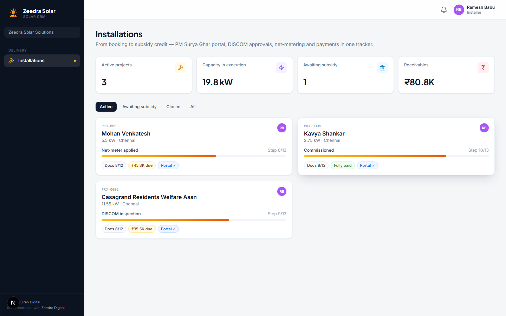
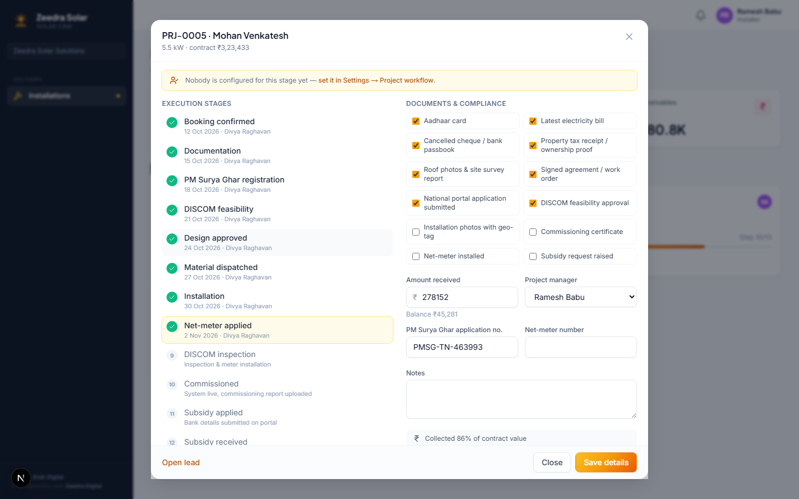

# Zeedra Solar CRM: Installer Guide

This guide is for an Installer. Your job starts once a deal is won. **Installations** is the only page you need, it is where you carry a project from booking through to installation, DISCOM approval and subsidy credit.

If you only need a quick refresher while you work, open **Help & guide** from the menu in the app.

## Contents

1. [Signing in](#signing-in)
2. [Installations](#installations)
3. [Opening a project](#opening-a-project)

---

## Signing in

Go to the sign-in page and enter your email and password. Click **Sign in**. You will land straight on the Installations board, since that is the only screen you work in.

---

## Installations

Every project assigned to you, with its stage, system size and how much money is still owed.

At the top, four tiles give you a quick summary: how many active projects you have, the total capacity you are installing, how many are waiting on subsidy, and how much money is still to be collected.

Use the tabs above the project cards, **Active**, **Awaiting subsidy**, **Closed** and **All**, to filter the list. Click any project card to open its full details.

---

## Opening a project

Click a project card to open it.

The left side shows **Execution stages**, the steps from booking confirmed all the way to subsidy received. Click a stage to mark it complete and move the project forward. The stage you are currently on is highlighted.

The right side has two parts:

- **Documents & compliance**: tick off paperwork as you collect it, such as the Aadhaar card, electricity bill, roof photos, the signed agreement, and later the commissioning certificate and net-meter installation.
- Fields for **Amount received**, the **PM Surya Ghar application number**, the **Net-meter number**, and free-text **Notes**.

Fill these in as the project progresses, and click **Save details** to store your changes. Keeping this up to date means your sales team and the office always know exactly where each installation stands, without having to call and ask you.

If you ever see a note saying nobody is set up to own the current stage, let your Admin or Owner know, they can fix this under Settings → Project workflow.

---

That covers everything you need as an Installer. If you ever need a reminder while you work, open **Help & guide** from the app.
