# Zeedra Solar CRM: Owner Guide

This guide is for the Owner of the business. As Owner, you can see and do everything in the system: every lead, every quotation, every installation, the full team list, and billing. You are the only person who can see the Billing & plan tab.

If you only need a quick refresher while you work, open **Help & guide** from the left sidebar inside the app. It shows the same information as this document, but right there on screen.

## Contents

1. [Signing in](#signing-in)
2. [Dashboard](#dashboard)
3. [Leads](#leads)
4. [Pipeline](#pipeline)
5. [Appointments](#appointments)
6. [Tasks](#tasks)
7. [WhatsApp](#whatsapp)
8. [Field App](#field-app)
9. [Quotations](#quotations)
10. [Field Tracking](#field-tracking)
11. [Installations](#installations)
12. [Automations](#automations)
13. [Solar Calculator](#solar-calculator)
14. [Settings](#settings)

---

## Signing in

Go to the sign-in page and enter your email and password. Click **Sign in**.

Once you are in, your home screen is the Dashboard.

### Your first week

1. Go to **Settings → Team** and add your sales managers, tele-callers, field sales reps and installers.
2. Check **Settings → Company**, **Pricing & subsidy** and **WhatsApp templates** so quotes and messages carry your real numbers and tone.
3. Turn on WhatsApp and Google Calendar under **Settings → Integrations** so messages and appointments sync on their own.
4. Open the Dashboard every morning. It is built to show you what needs attention in under a minute.

---

## Dashboard

The Dashboard is your home screen. It shows new leads, hot leads still open, visits scheduled today, pipeline value, this month's wins, and anything overdue.

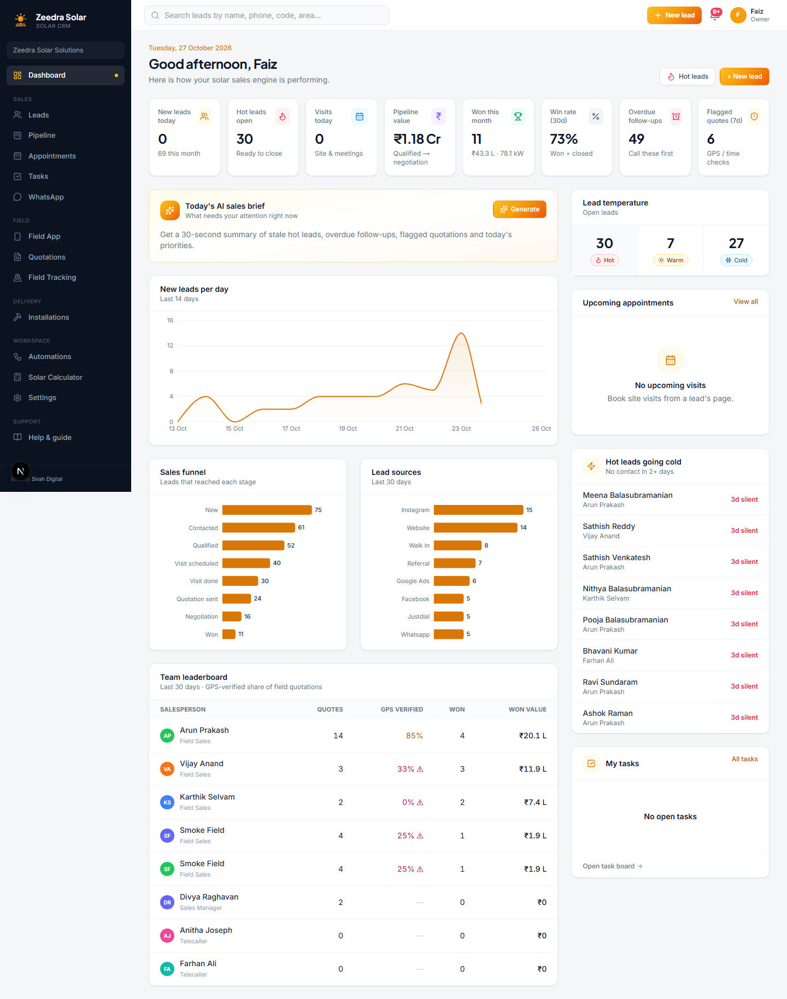

What you can do here:

- Click any stat tile, such as **Hot leads open** or **Overdue follow-ups**, to jump straight to that list.
- The charts in the middle show new leads per day, your sales funnel by stage, and where leads are coming from.
- Click **Generate** on the **Today's AI sales brief** card for a short written summary of what needs your attention.
- The **Team leaderboard** ranks your sales staff by quotes made, how many were GPS-verified, and deals won.
- On the right, **Upcoming appointments**, **Hot leads going cold** and **My tasks** are your "do this next" list.

---

## Leads

Every enquiry your business receives lands here, whatever the source: website, Facebook, Google Ads, a walk-in, or typed in by a tele-caller.

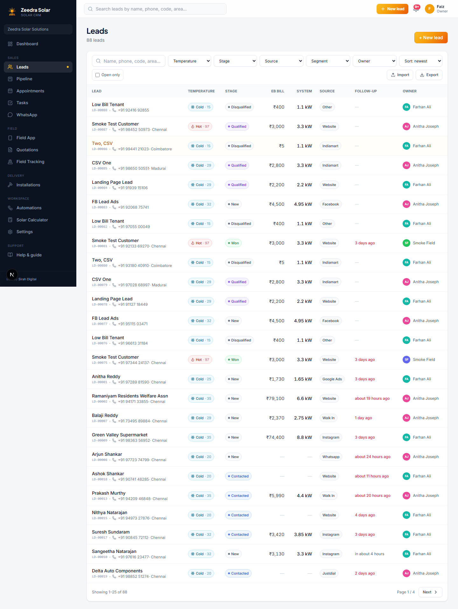

Use the search box and the Temperature, Stage, Source and Owner filters to find a lead. Click any row to open it.

### Adding a lead by hand

Click **+ New lead** to open the form. Fill in the customer's name, phone number, and whatever you know about their site and electricity bill. The more you add, the better the instant estimate on the right.

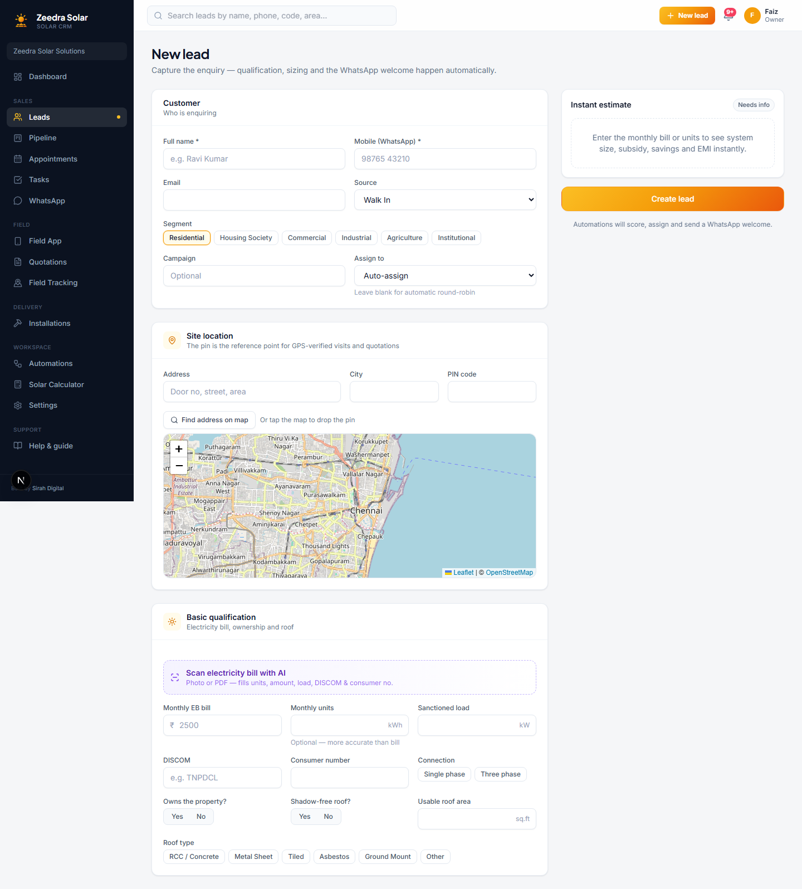

Click **Create lead** when you are done. The system scores the lead, assigns it, and sends a WhatsApp welcome message automatically.

### Working a lead

Open any lead to see its full workspace: a header with quick actions, five tabs, and a side column with the AI co-pilot and lead score.

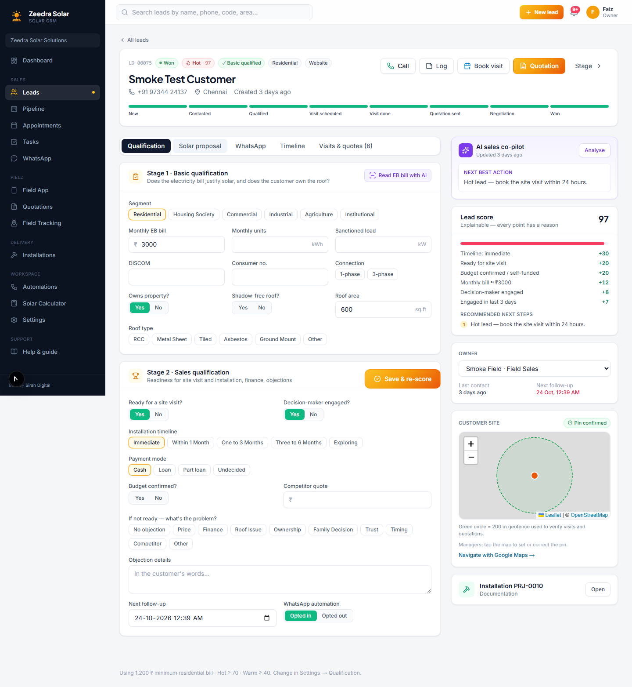

- **Qualification tab**: record what the customer told you (bill amount, roof type, ownership, timeline, budget). Click **Save & re-score** when you are done.
- **Solar proposal tab**: see the recommended system size and finance options, and create a quotation from here.
- **WhatsApp tab**: the full chat history with the customer, with templates you can send in one click.
- **Timeline tab**: every call, note, message and stage change, logged automatically.
- **Visits & quotes tab**: book a visit or start a quotation for this lead.

### AI sales co-pilot

Click **Analyse** on the card in the right column. It tells you the next best action, explains why the lead is hot, warm or cold, flags objections, and can draft a ready-to-send WhatsApp message for you.

### Booking a visit

Click **Book visit** in the lead header. Pick the visit type, who should go, and a time slot. Slots are worked out automatically from working hours and travel time between visits.

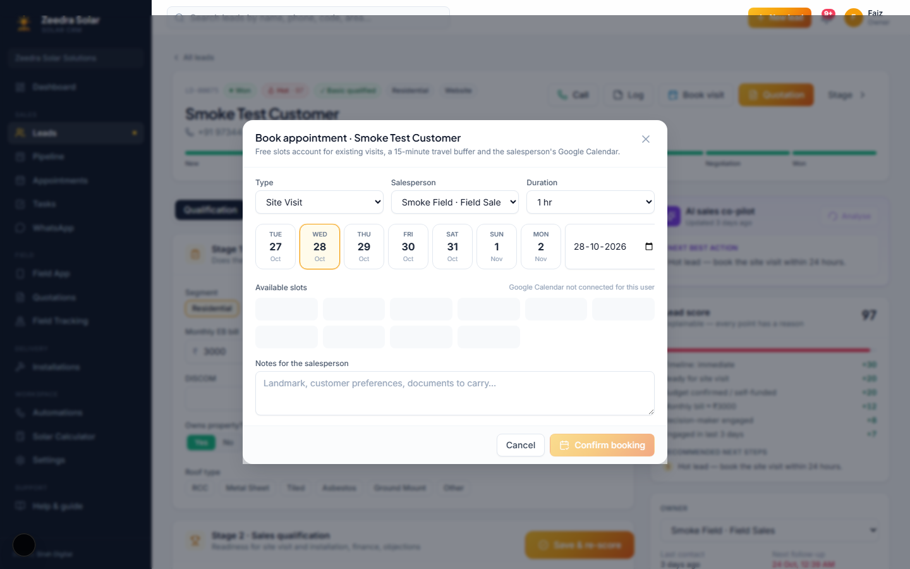

---

## Pipeline

Pipeline shows every open deal as cards on a board, grouped by stage.

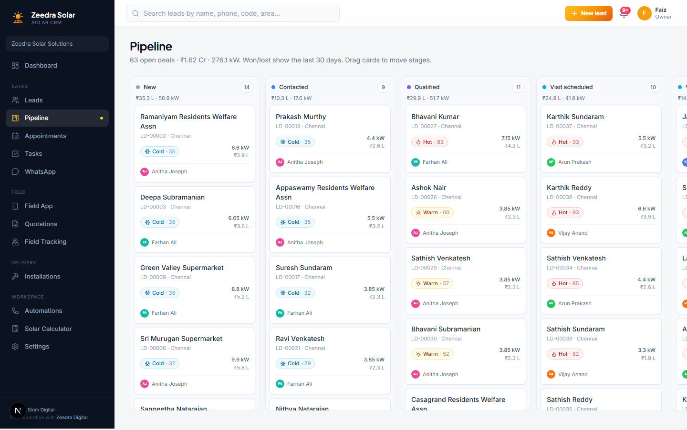

Drag a card into a new column to move it to that stage. Click a card to open the lead. Use this view to spot deals that have been sitting in one stage too long.

---

## Appointments

Appointments is your team's weekly calendar of site visits, quotation meetings and installation visits.

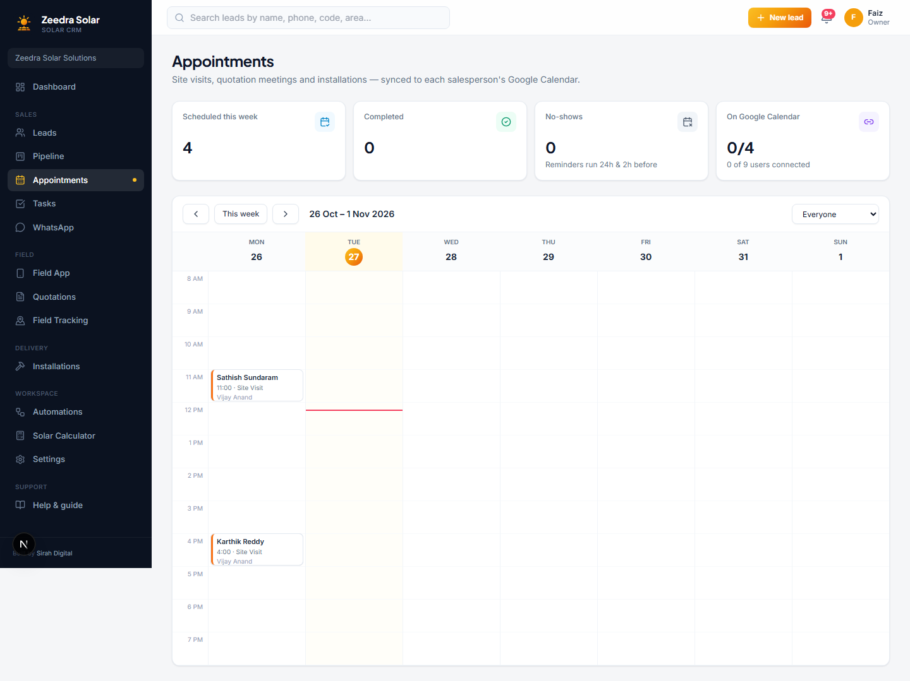

You book a new appointment from inside a lead's page (the **Book visit** button), not from here directly. If a salesperson has connected their Google Calendar, from their own profile, the appointment goes there too, and reminders go out 24 hours and 2 hours before the visit.

---

## Tasks

Tasks is a follow-up to-do list. Most tasks are created automatically by automations, but anyone can add one manually from a lead's Timeline tab.

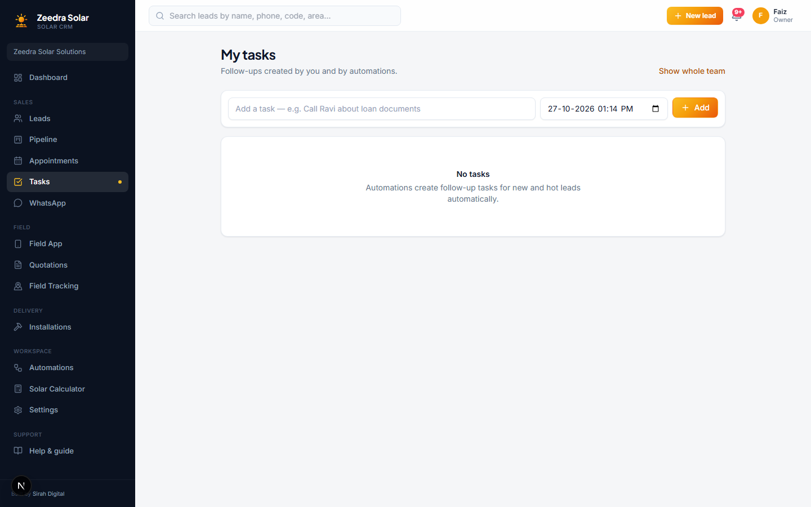

As Owner, you can switch between **Show only mine** and **Show whole team** to see what everyone is working on.

---

## WhatsApp

This is a single inbox for every WhatsApp conversation with every lead, automated and manual.

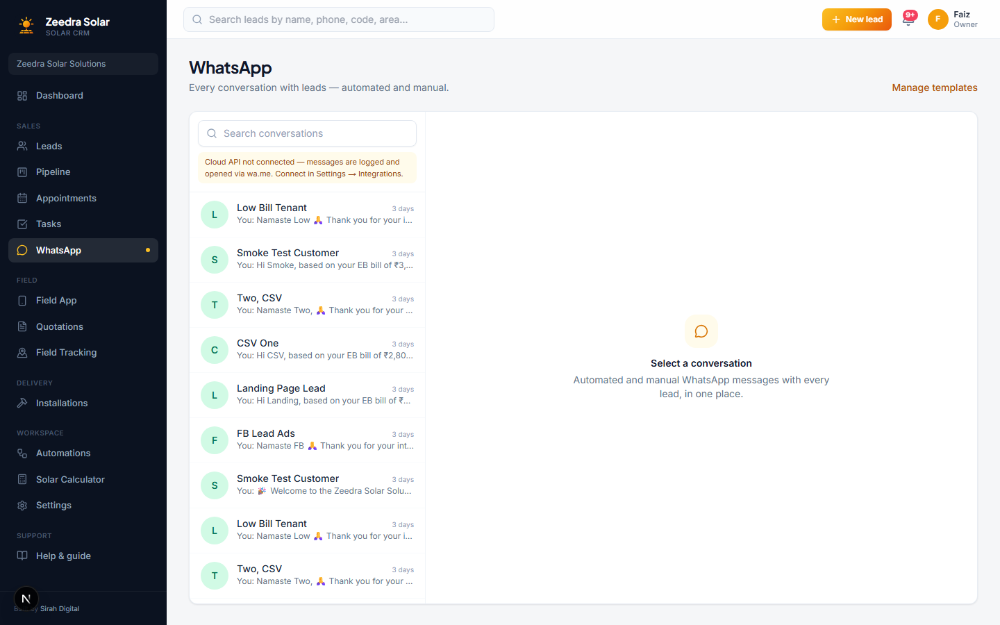

Click a conversation to open it and reply. Use **Manage templates** to set up reusable replies so your team does not have to type the same message twice.

---

## Field App

The Field App is built for your field sales reps to use on their phones, but anyone with quotation access, including you, can open it from a desktop too.

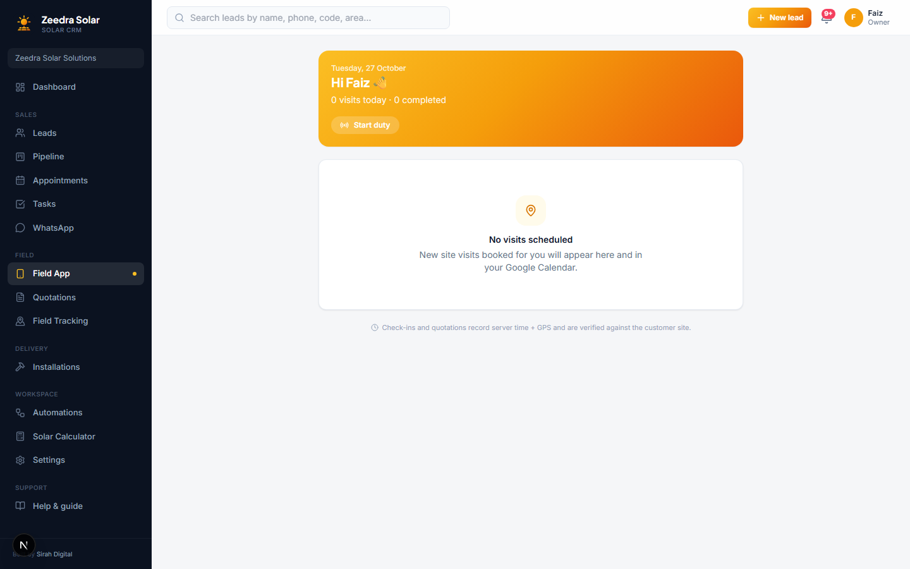

It lists the day's visits as cards, with buttons to navigate, call, check in with GPS, build a quotation on the spot, and mark the visit complete.

---

## Quotations

Every solar proposal your team has created, with its status, price, system size, and whether it was verified as created at the customer's site.

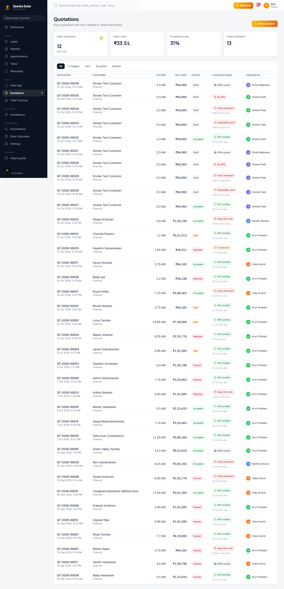

Use the **⚠ Flagged** tab to see quotes that could not be confirmed as created on site. Click a quotation to open it and review the details.

### Quoting someone who isn't a lead yet

Click **+ New quotation** at the top of the Quotations page. Instead of picking an existing lead, you get a **New customer** form right there: name, phone, address and their electricity bill. Fill it in, set up the system the same way you would for any other quote, and click **Create quotation**.

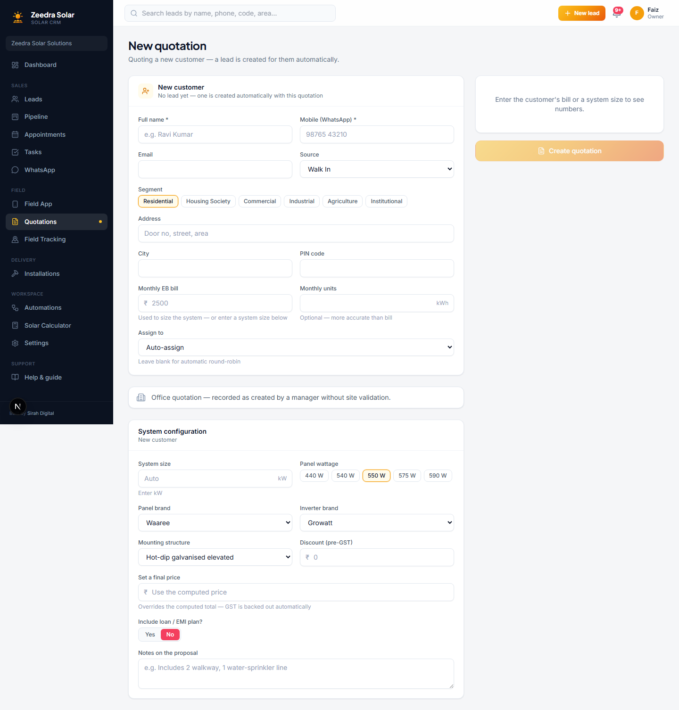

A lead is created for the customer automatically the moment the quotation is created, scored and assigned just like one entered through the Leads page. If a lead with that phone number already exists, the quotation is simply added to it instead of creating a duplicate, and you'll see a note telling you which existing customer it matched.

### Opening a quotation

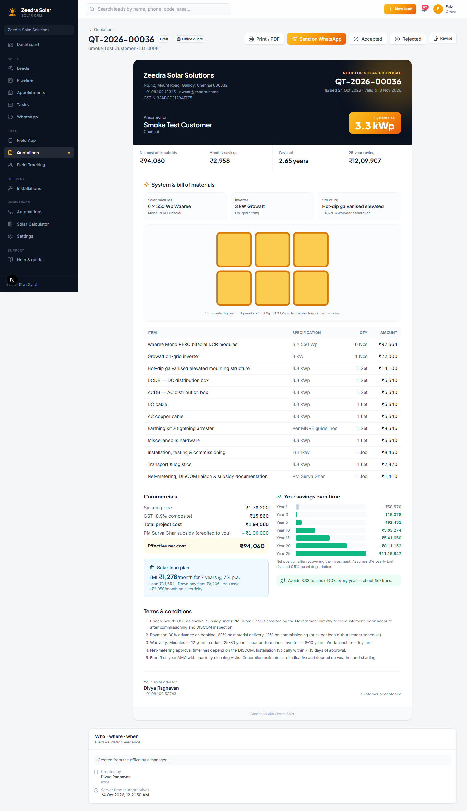

From here you can print the quotation, copy a shareable customer link, resend it on WhatsApp, or review a flagged location check.

### Revising a quotation

If a price needs to change after a quote was already sent or reviewed, click **Revise** instead of editing it. You can set a new discount, type a different final price, or update the notes, system size stays the same. The original is kept exactly as it was, and the new version carries the same quote number with a revision mark (**Rev. 2**, **Rev. 3**, and so on). A **Version history** list on the quotation page shows every revision and which one is current.

---

## Field Tracking

A live map of your field sales team: where they are right now, how many check-ins they have done today, and how trustworthy their quotations are.

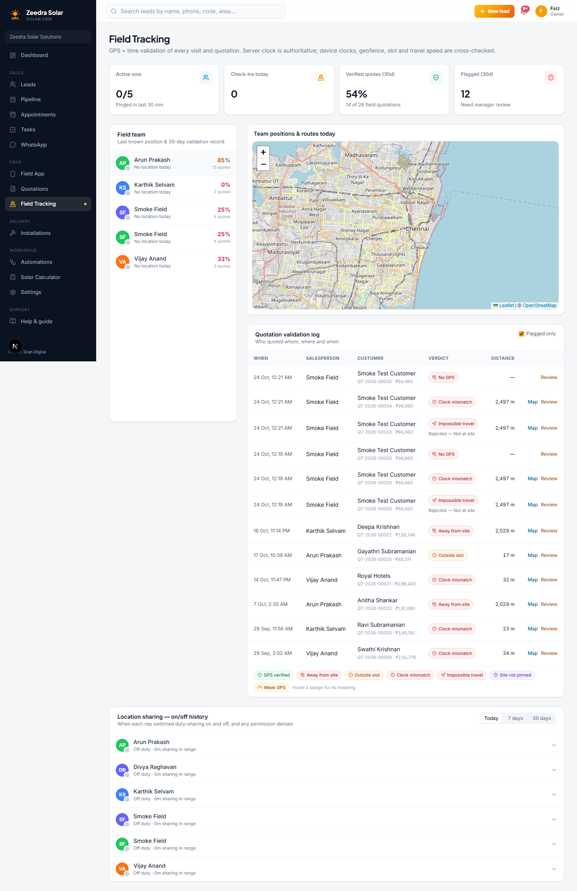

Use this to notice a rep who has gone quiet, or to review a quote that was flagged for being created far from the customer's address.

---

## Installations

When a deal is marked Won, it becomes a project here automatically. This is where your team tracks the job from booking through to subsidy credit.

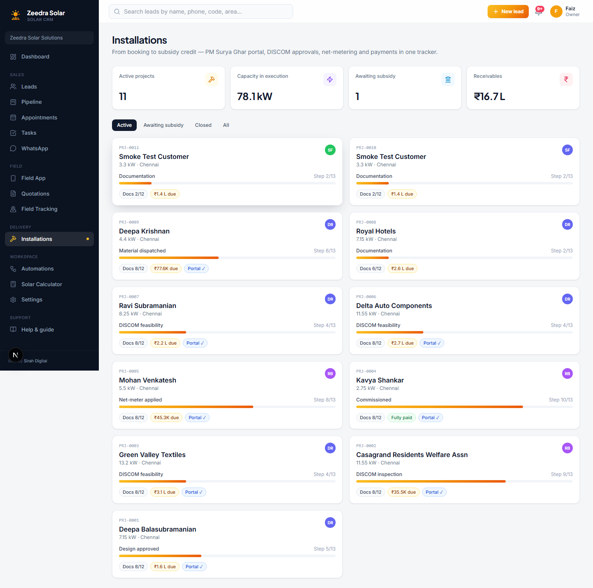

Click a project card to open its details.

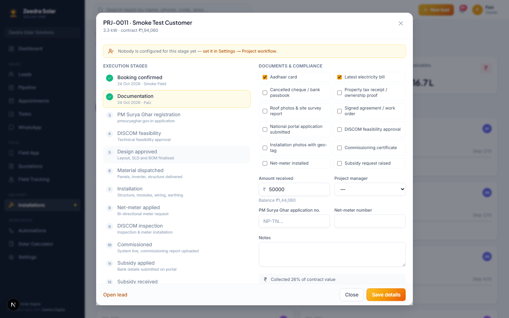

Inside, you can:

- Tick off each **Execution stage** as the project moves forward (Documentation, DISCOM feasibility, Installation, Net-meter applied, and so on).
- Tick items in **Documents & compliance** as paperwork comes in.
- Keep **Amount received**, the **PM Surya Ghar application number** and **Net-meter number** up to date.

Set who is responsible for each stage under **Settings → Project workflow**, so the right person always knows it is their turn.

---

## Automations

Automations run parts of your sales playbook for you, written as simple "WHEN this happens, IF these conditions are true, THEN do this" rules.

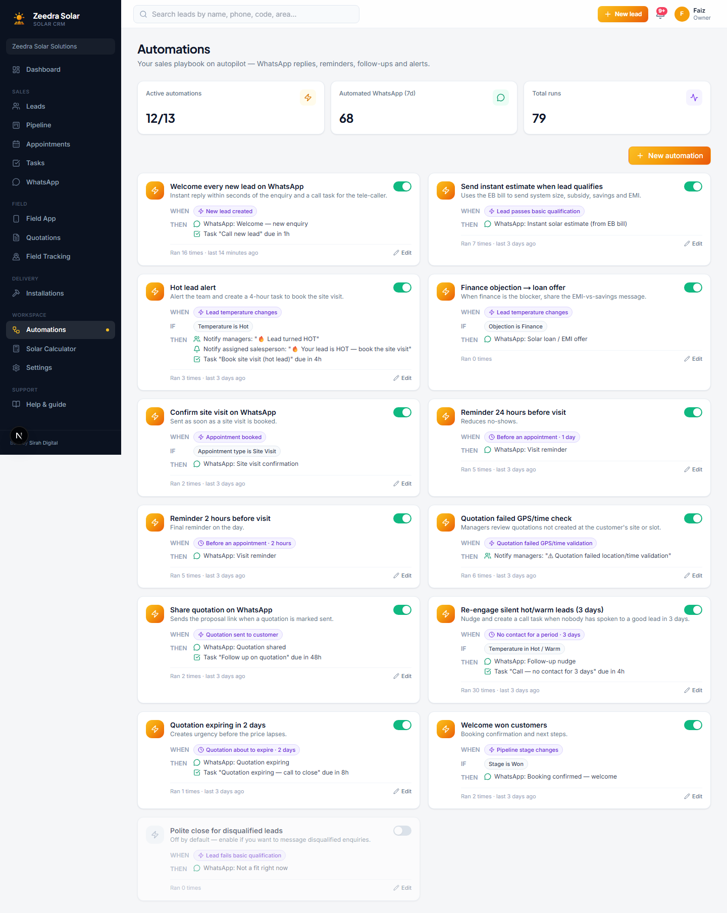

For example: WHEN a lead is created, THEN send a WhatsApp welcome message. Or: WHEN a hot lead has had no contact for two days, THEN notify the sales manager. Turn any rule on or off with its switch, or click it to edit the conditions and actions.

---

## Solar Calculator

A quick calculator you can use live on a call, without needing a lead on file. Enter a monthly electricity bill and instantly see the recommended system size, subsidy, savings and EMI options.

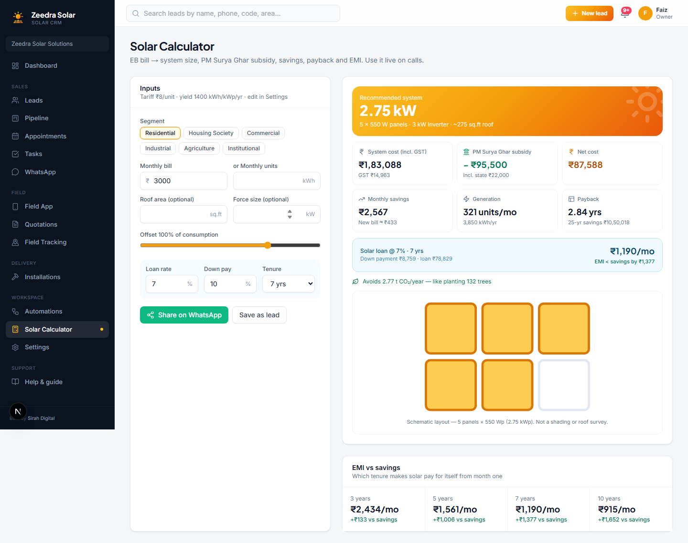

---

## Settings

Settings is where you configure how the business runs. As Owner, you see every tab.

### Company

Your business name, contact details, address, GSTIN and logo. This information shows up on every proposal and WhatsApp message you send.

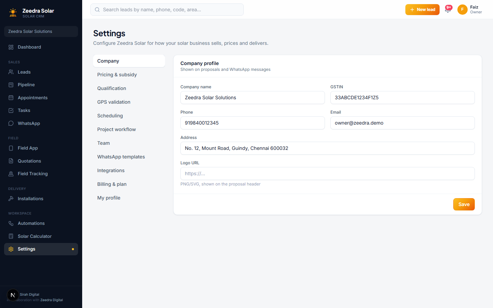

### Pricing & subsidy

The rates and rules that drive every quotation, lead score and instant estimate in the app.

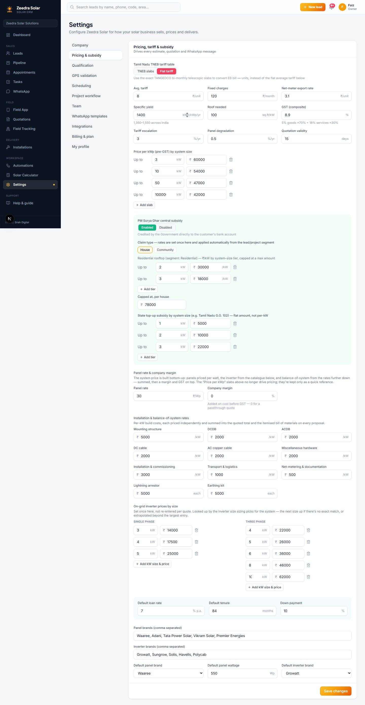

Every quotation is priced bottom-up: the panel rate (₹ per watt), the inverter catalogue below, and the per-kW balance-of-system rates (mounting, cabling, installation, and so on) are added up to get the system price, then a **Company margin** and GST are applied on top. Set **Company margin** to 0% for a straight passthrough quote, or a percentage if you want every quote to carry a margin automatically.

If your business is in Tamil Nadu, turn on **TNEB slabs** at the top of this page. Instead of a flat average tariff, every bill the team enters is converted to units using the exact TANGEDCO bi-monthly telescopic rate table, so estimates match what the customer actually pays.

### Team

Click **Add user** to invite someone new. Enter their name, email, role and a temporary password, then share the password with them directly. You can change anyone's role from the dropdown, or deactivate someone when they leave (their open leads go back into the pool automatically).

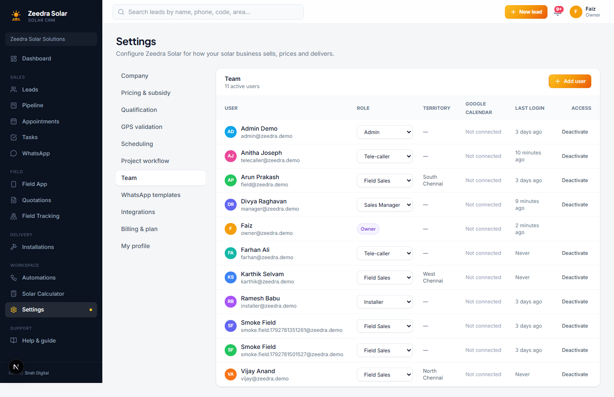

### WhatsApp templates

Reusable message templates your team can send with one click, instead of typing the same thing over and over.

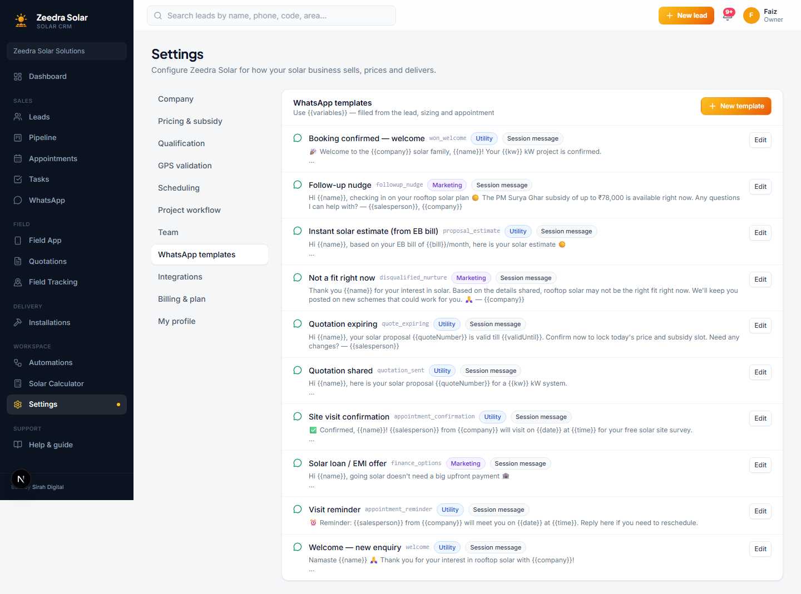

### Integrations

Connect your WhatsApp Cloud API account, check your Google Calendar setup, see whether the AI assistant is active, and find your lead-capture API key for your website and ad forms.

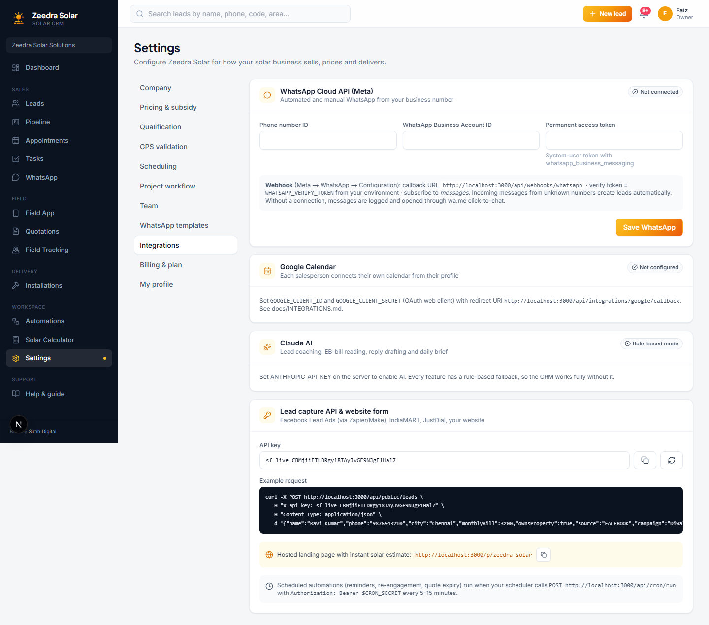

### Billing & plan

This tab is visible to you only. Manage your subscription plan and billing details here.

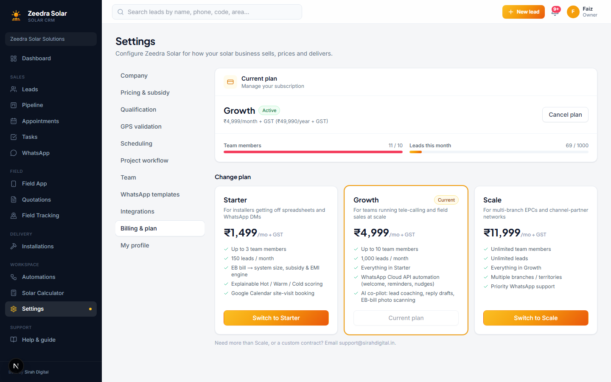

### My profile

Everyone, including you, can reach their own profile from the person icon in the top right corner. Update your details, connect your personal Google Calendar, or change your password. You can also set a **Quick PIN login**, a short 4-6 digit code, so you can sign in faster on a device you use often. On the sign-in page, click **Use a quick PIN instead** and enter your email and PIN instead of your password.

---

That covers everything you can do as Owner. If you ever need a reminder while you work, the **Help & guide** page inside the app has the same content, filtered to whatever you are signed in as.
