# Zeedra Solar CRM: Roof Design & Shading Guide

This guide shows you how to design a rooftop solar system on a satellite map: draw the roof, place the panels, check shading, wire the strings, and share a 3D view with your customer. It works for any address, with or without a lead.

You'll find the tool under **Roof Design** in the left sidebar, or press **Roof design** on any lead's page.

## Contents

1. [Start a new design](#start-a-new-design)
2. [Draw the roof](#draw-the-roof)
3. [Line the panels up with the roof](#line-the-panels-up-with-the-roof)
4. [Move the whole panel array](#move-the-whole-panel-array)
5. [Move, rotate or add single panels](#move-rotate-or-add-single-panels)
6. [Use a different panel on one roof](#use-a-different-panel-on-one-roof)
7. [Add blockers (tanks, rooms, trees)](#add-blockers-tanks-rooms-trees)
8. [Check shading](#check-shading)
9. [Wire the strings and cables](#wire-the-strings-and-cables)
10. [See it in 3D](#see-it-in-3d)
11. [Share it with your customer](#share-it-with-your-customer)
12. [Quick tips](#quick-tips)

## Start a new design

Open **Roof Design** and fill in **New design** on the right.

- **Design name:** anything that helps you find it later, like "Kumar residence terrace".
- **Site location:** type an address or landmark and press the search button, or paste coordinates such as `13.04215, 80.23445`. You can also click the roof on the satellite map, or press the location button when you're standing on site.

Then press **Open design editor**.

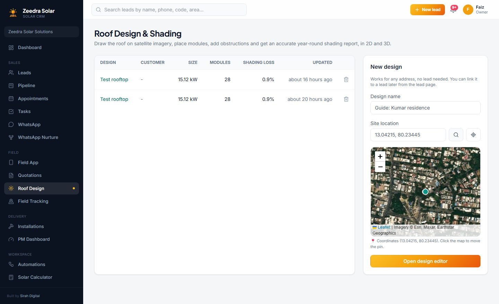

The editor opens on the satellite view. Zoom in with your mouse wheel until the roof fills most of the screen.

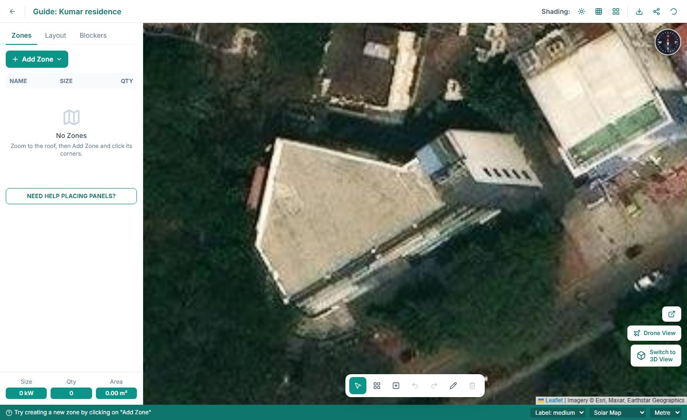

## Draw the roof

1. In the **Zones** tab, press **Add Zone** and pick the roof type:
   - **Flat / RCC:** a concrete roof. Panels sit on a tilted structure.
   - **Tilted Roof:** a sloped roof. Panels lie flat on the slope.
   - **Shed:** an elevated structure on legs, clear of the parapet walls.
2. Click each corner of the roof on the map. The length of each side shows as you draw, so you can match it to your site measurements.
3. Click the first corner again (or double-click) to finish.

Panels fill the roof straight away, keeping the setback from the edges and a row gap that stops one row shading the next.

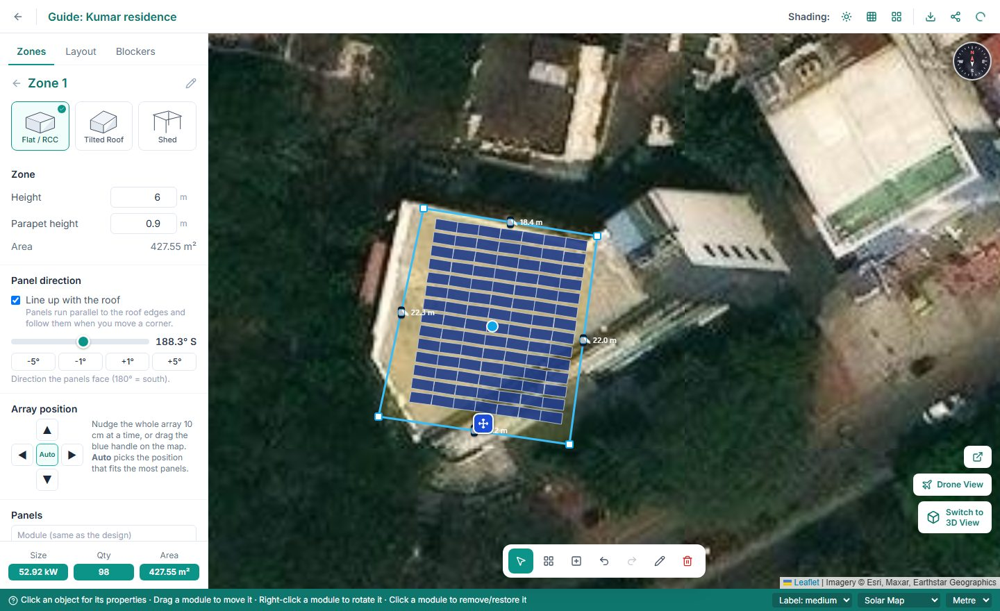

Set the roof's **Height** (the building height) and **Parapet height** in the panel on the left. These decide what casts shadows, so measure them on site if you can. To fix a corner later, select the zone and drag the small white squares.

## Line the panels up with the roof

Most roofs aren't perfectly north-south. **Line up with the roof** is switched on for every new zone, so the panels run parallel to the roof edges, the way installers mount them. When you drag a corner, the panels follow.

If you want a different direction, drag the **Panel direction** slider or use the **-5°, -1°, +1°, +5°** buttons. This turns "Line up with the roof" off. Tick it again to snap back to the roof.

180° means the panels face due south. Turning them 10 to 15 degrees away from south to match the roof costs well under 1% of the yearly energy.

## Move the whole panel array

Sometimes the array sits a little too close to a vent, a pipe or the stairs. You can slide the whole block of panels:

- **Drag the blue handle** just in front of the array on the map, or
- Use the **arrow buttons** under **Array position** to move it 10 cm at a time.

Press **Auto** to go back to the position that fits the most panels.

## Move, rotate or add single panels

**Move a panel:** press on it and drag it to a new spot. It becomes a hand-placed panel and stays where you put it.

If a panel ends up overlapping another panel, hanging over the roof edge, sitting inside the setback or too close to a blocker, it gets a **red outline**. Hover over it to see why, then drag it to a free spot.

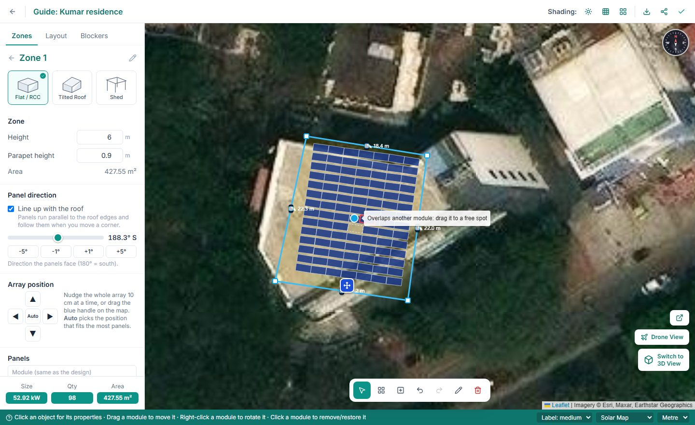

**Rotate a panel:** right-click it and choose **Rotate 90°** (switch between portrait and landscape) or **Turn 15°**.

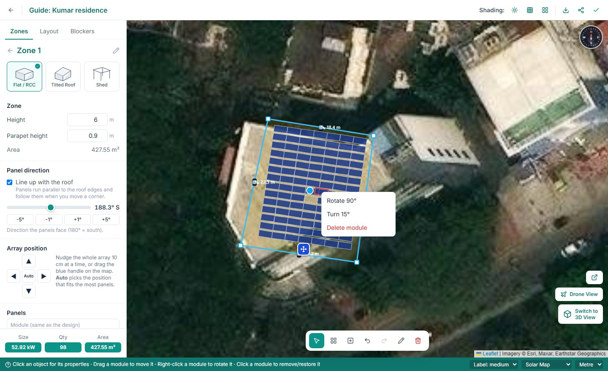

**Add a panel:** press the **Add panel** button in the toolbar at the bottom (the square with a plus), then click inside the roof wherever you want a panel. Press **Esc** when you're done. Panels can only be placed inside a roof zone.

**Remove a panel:** click it once. Click the empty outline again to bring it back. Hand-placed panels are deleted when clicked.

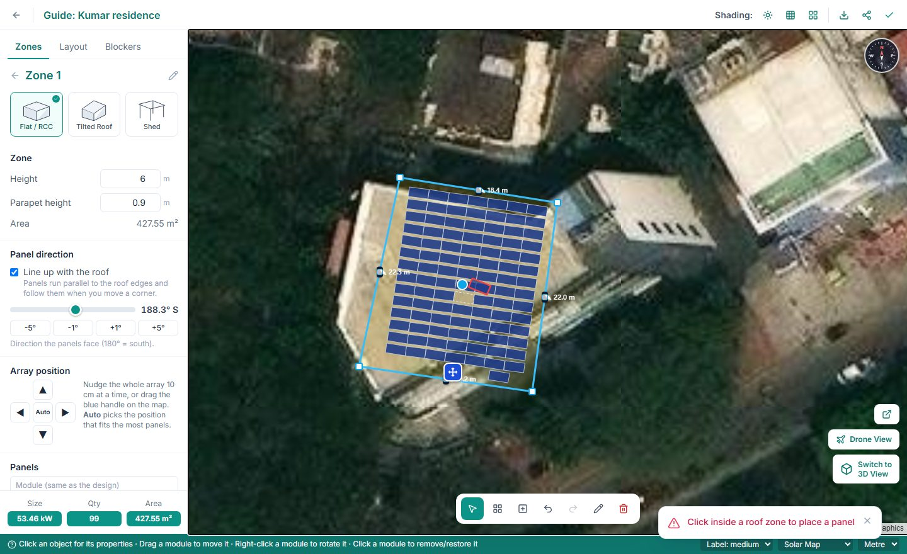

## Use a different panel on one roof

By default every roof uses the design's panel. To use a different one on a particular roof (for example bigger panels on the main terrace), select the zone, then click the **Module** box under **Panels** and pick from the catalog. You can search by brand, model or wattage, tick **DCR only** for subsidy-eligible panels, or add your own with **+ Custom**.

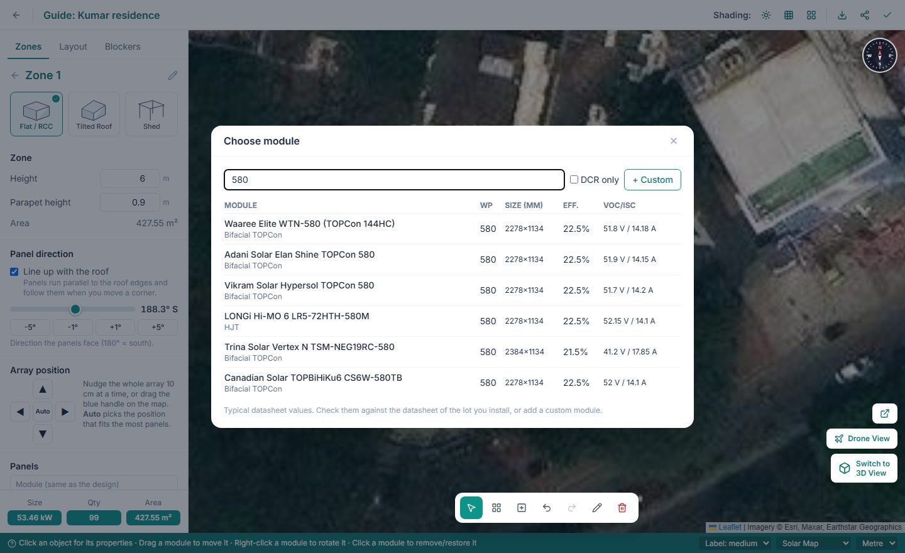

The zone's size and the system total update straight away. Press **Use the design's module** to go back. When you auto-string a design with mixed panels, each panel type gets its own inverter, because different panels should never share a string.

## Add blockers (tanks, rooms, trees)

Anything taller than the panels can shade them. Add each one so the shading result is accurate.

1. Open the **Blockers** tab and press **Add Blocker**.
2. Pick **Rectangle** (staircase or lift room), **Polygon** (any shape, like a neighbouring building), **Circle** (water tank) or **Tree**.
3. Draw it on the map: click two corners for a rectangle, or the centre and then the edge for a circle or tree.
4. Set its real **Height**. A blocker drawn on a roof automatically starts at that roof's height; trees in the yard start at the ground.

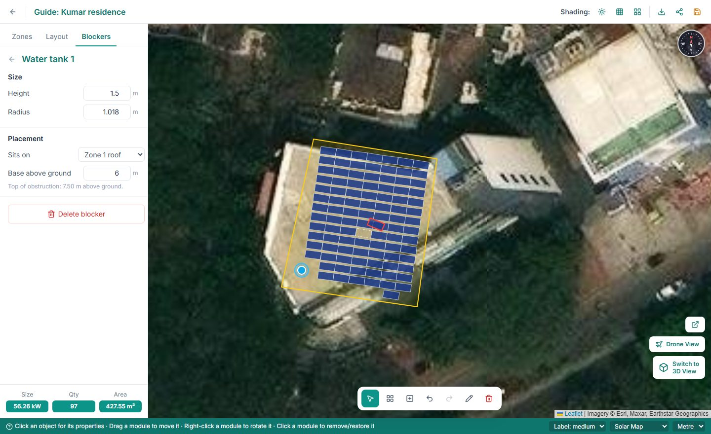

## Check shading

**Live shadows:** press the sun button at the top (next to **Shading**). Drag the **Date** and **Time** sliders, or press play, to watch the shadows move across the roof. **JUNE 21** and **DEC 21** jump to the longest and shortest days.

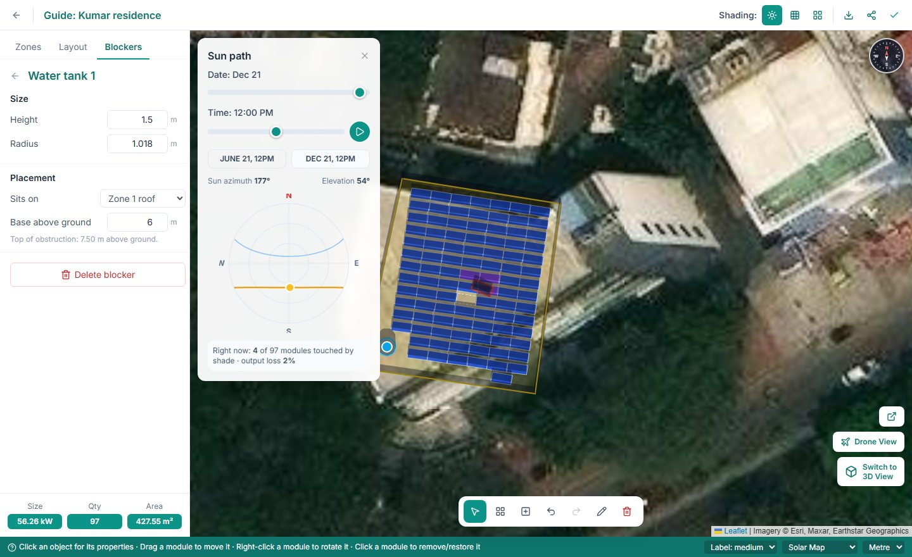

**Yearly heatmap:** press the grid button next to it. Each panel is coloured by how much sunlight it gets over a whole year:

- **Green:** 95% or more, no real shading
- **Yellow and orange:** some shading
- **Red:** less than 70%, worth moving or removing

Press the green box at the bottom left for the full results: shading loss, yearly energy, and generation month by month. The calculation uses the local weather for the site, and it counts the way one shaded cell can switch off part of a panel, so it's stricter than tools that only measure shaded area.

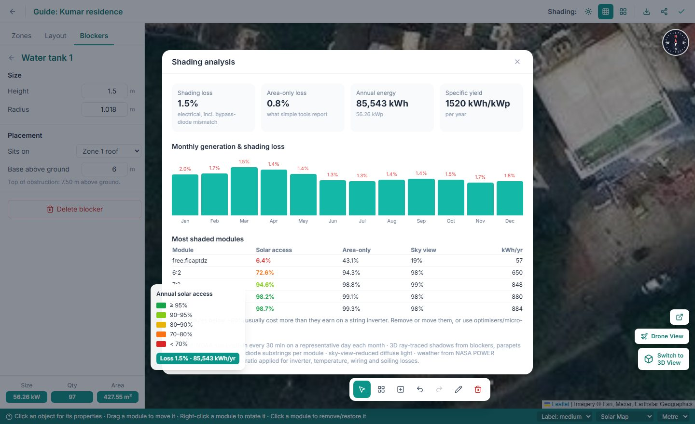

## Wire the strings and cables

Open the **Layout** tab.

**Inverter:** press **Auto-string**. It picks a suitable inverter for the system size if you haven't added one, and wires every panel into strings that stay within the inverter's voltage limits at your site's hottest and coldest temperatures. **Panels left to string** should read 0. Any problem appears in red under the string.

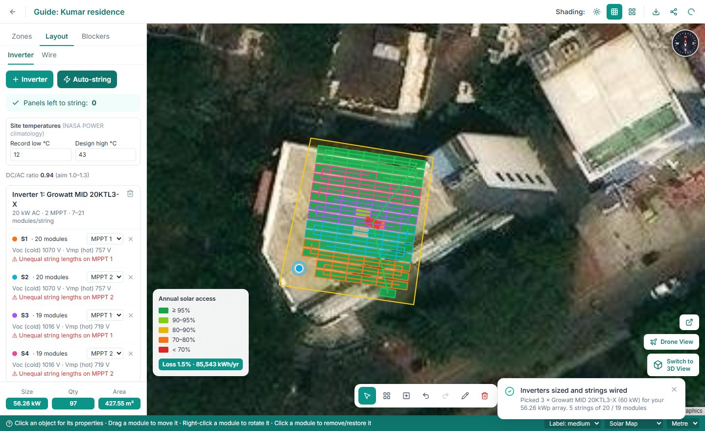

**Wire:** press **Place inverter on map** and click where the inverter will be mounted. You'll see the DC cable length and voltage drop for each string, the AC cable size, and a cable bill of materials.

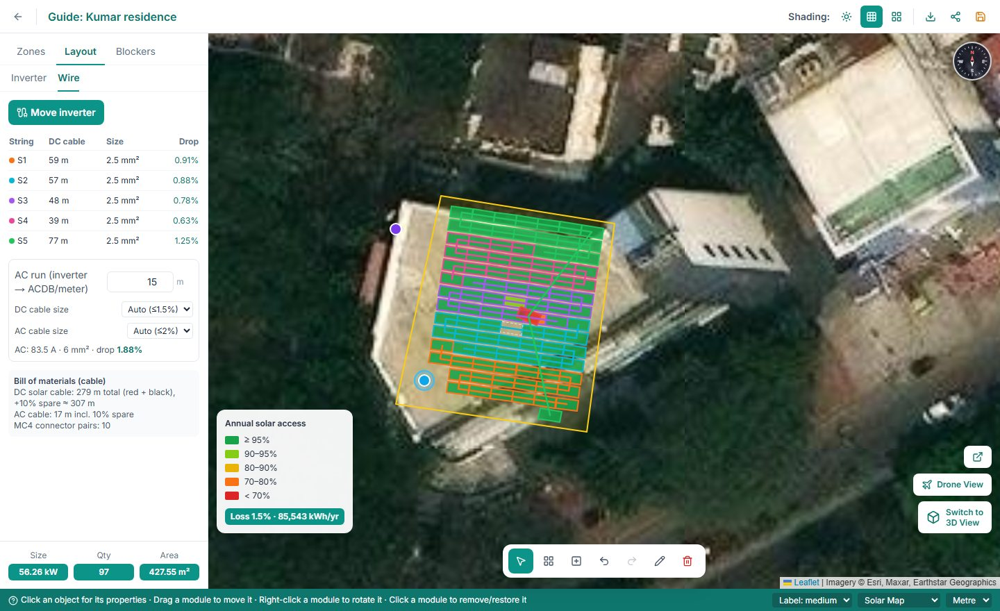

## See it in 3D

Press **Switch to 3D View** on the right. Drag to look around and scroll to zoom. Each roof shows a label with its panel count and size, and the shadows follow the sun-path time.

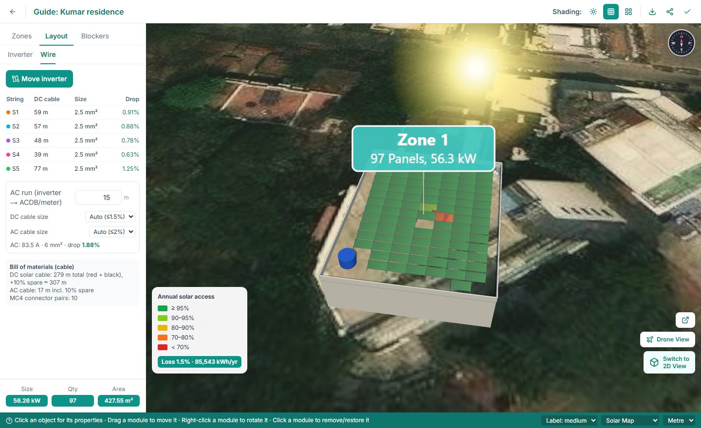

## Share it with your customer

Press the share button at the top right to get a private link. Send it on WhatsApp or email. Your customer can turn the 3D model, slide through the sun path and see their system size and yearly energy, without signing in. Press **Revoke link** in the same box to switch it off.

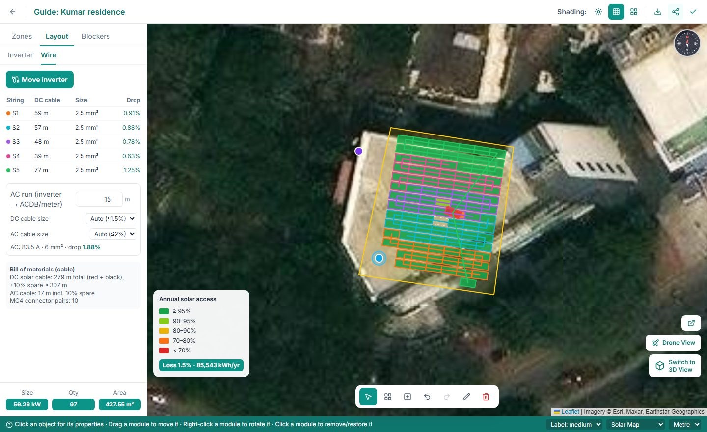

This is what your customer sees:

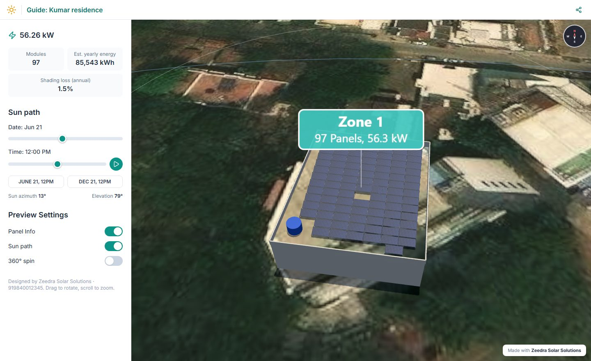

If the customer has a quotation, the same 3D design also appears inside the quotation link you send them.

## Quick tips

- **Undo / redo:** Ctrl+Z and Ctrl+Y, or the arrows in the bottom toolbar.
- **Saving:** your design saves automatically a couple of seconds after each change. The tick at the top right means it's saved.
- **Right-click** a zone or blocker for Properties, Duplicate and Delete.
- **Drone View** lets you lay your own drone photo over the map when the satellite image is old or blurry. Drag its corner handles to line it up.
- **Delete a design** from the Roof Design list with the bin icon at the end of its row.
- Can't see the **Roof Design** menu? Ask your admin to tick **Roof Design** for you in Settings, Team.
