# Zeedra Solar CRM: Sales Manager Guide

This guide is for a Sales Manager. You run the sales team day to day. You can see every lead in the business, assign work, review quotations your field reps created, and manage automations. Settings and Billing stay with the Owner and Admin, but your own profile is always available to you.

If you only need a quick refresher while you work, open **Help & guide** from the left sidebar inside the app.

## Contents

1. [Signing in](#signing-in)
2. [Dashboard](#dashboard)
3. [Leads](#leads)
4. [Pipeline](#pipeline)
5. [Appointments](#appointments)
6. [Tasks](#tasks)
7. [WhatsApp](#whatsapp)
8. [Quotations](#quotations)
9. [Field Tracking](#field-tracking)
10. [Installations](#installations)
11. [Automations](#automations)
12. [Solar Calculator](#solar-calculator)
13. [My profile](#my-profile)

---

## Signing in

Go to the sign-in page and enter your email and password. Click **Sign in**.

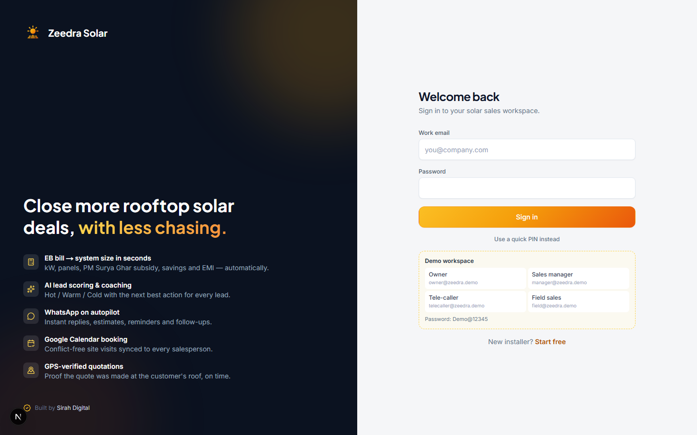

### Your first week

1. Check the Dashboard every morning for hot leads, overdue follow-ups, and how your team is performing.
2. Open **Leads** and **Pipeline** to see who is working what, and reassign if someone is overloaded.
3. Check the **⚠ Flagged** tab in Quotations regularly. These are quotes your field team made somewhere GPS could not confirm, and they need your review.
4. Visit **Field Tracking** to see where your field reps are and how reliable their check-ins have been.

---

## Dashboard

The Dashboard shows new leads, hot leads still open, visits scheduled today, pipeline value, this month's wins, and anything overdue.

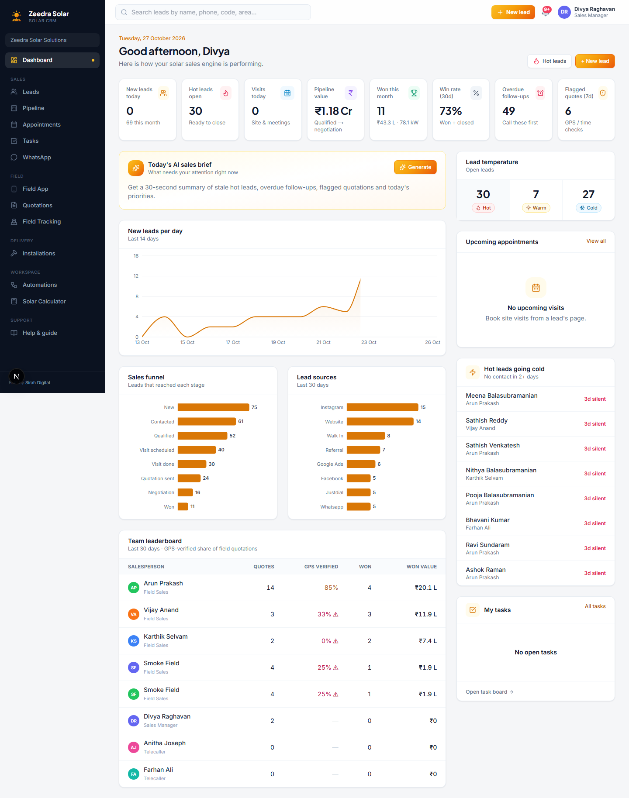

As a manager, you also see the **Today's AI sales brief** card and the **Team leaderboard**, which ranks your sales staff by quotes made, how many were GPS-verified, and deals won. Click any stat tile to jump straight to that filtered list.

---

## Leads

Every enquiry your business receives, from every source, and from every member of your team.

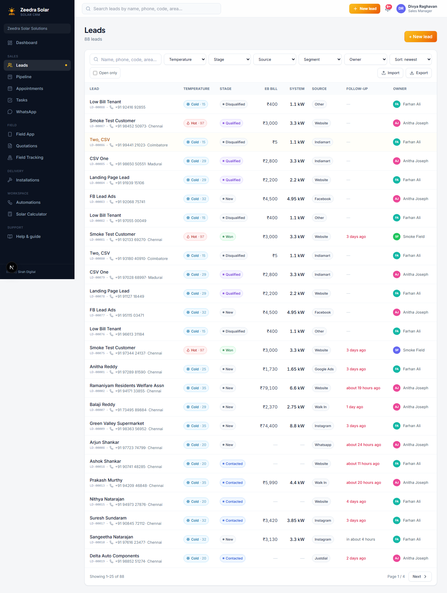

Use the search box and the filters (Temperature, Stage, Source, Owner) to find leads. Click a lead's name to open its full workspace.

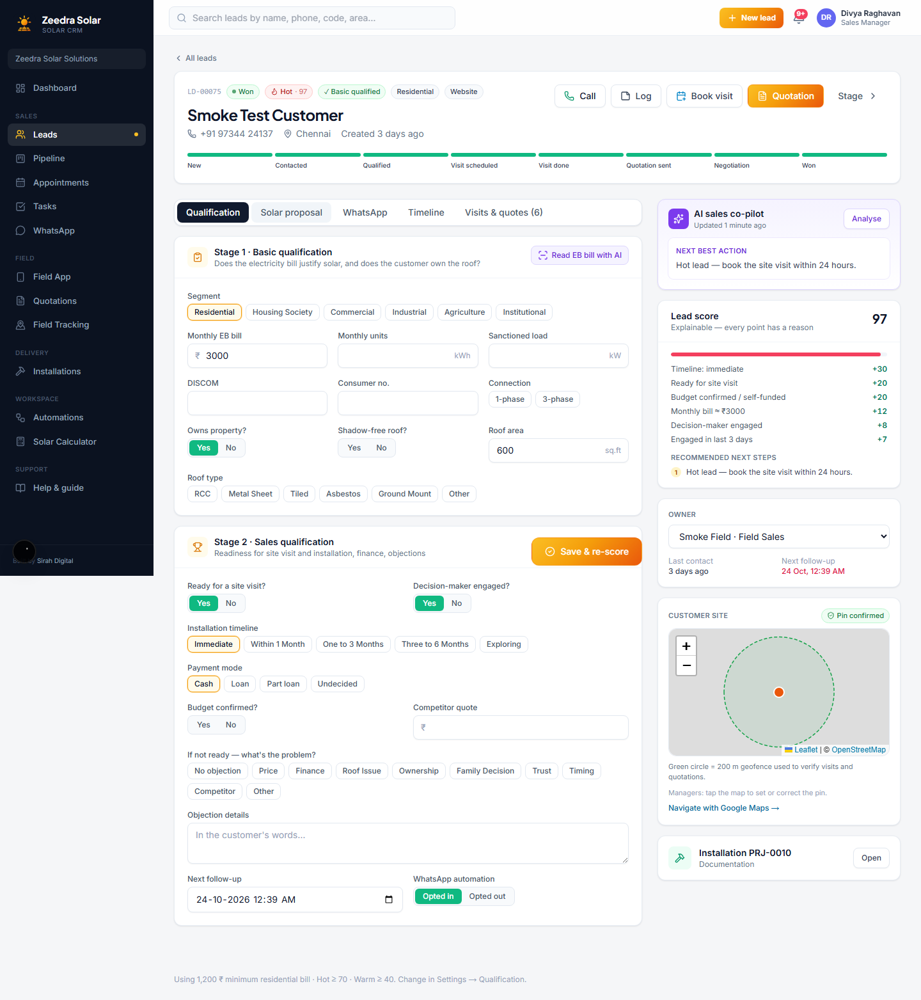

As a manager, you can reassign a lead to a different team member from the **Owner** card on the right, and you can import a batch of leads from a CSV file using the **Import** button on the leads list.

---

## Pipeline

Every open deal as cards on a board, grouped by stage.

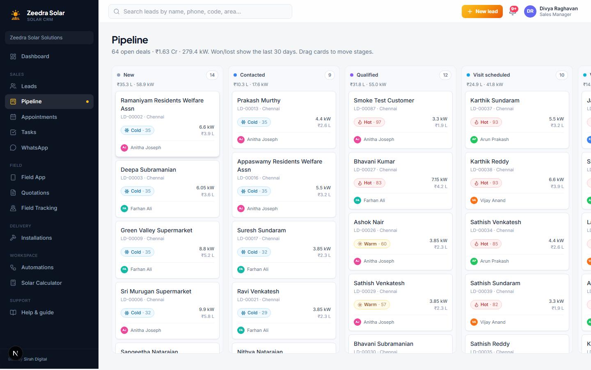

Drag a card into a new column to move it to that stage. Use this view to spot deals that have been sitting in one stage too long, across your whole team.

---

## Appointments

Your team's weekly calendar of site visits, quotation meetings and installation visits.

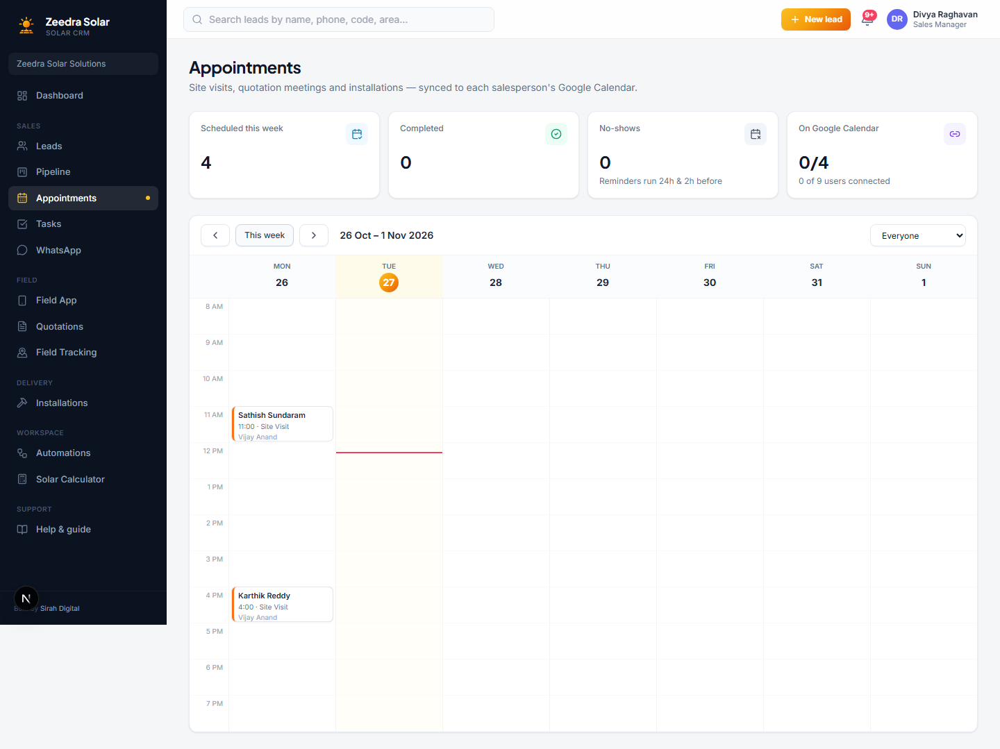

As a manager, you can filter this calendar by team member to check anyone's schedule.

---

## Tasks

A follow-up to-do list, created automatically by automations or added manually from a lead's Timeline tab.

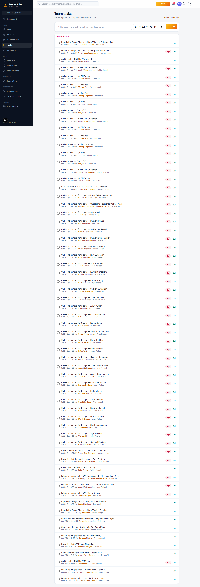

Click **Show whole team** to see every open task across your team, not just your own. This is a good place to check who has fallen behind on follow-ups.

---

## WhatsApp

A single inbox for every WhatsApp conversation across your team's leads, automated and manual.

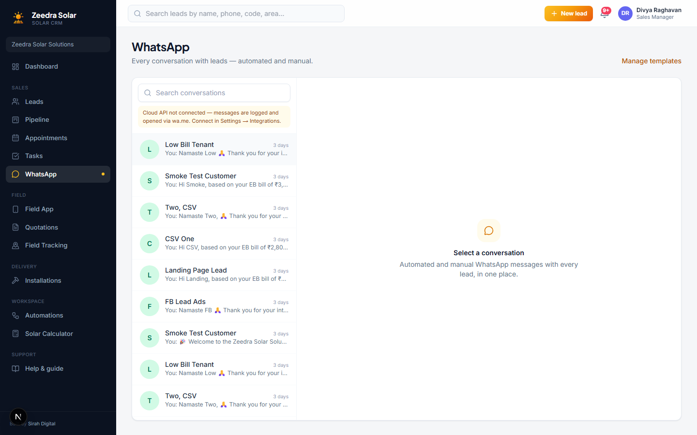

Click a conversation to open it and reply, or use **Manage templates** to set up reusable messages.

---

## Quotations

Every quotation your team has created, with its status, price, system size, and whether it was verified as created at the customer's site.

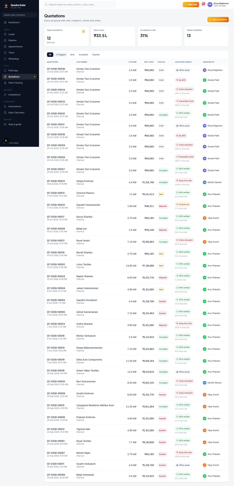

This is one of your most important screens. Click the **⚠ Flagged** tab to find quotes your field team created somewhere the app could not confirm as the customer's address. Open one to review the GPS details and approve or reject the flag.

Click **+ New quotation** to quote someone who isn't in the system yet, for example a walk-in or a phone enquiry. Fill in their name, phone and bill right in the quote builder and a lead is created for them the moment you create the quotation, scored and assigned like any other lead. If that phone number already exists, the quote is simply added to the existing lead instead of making a duplicate.

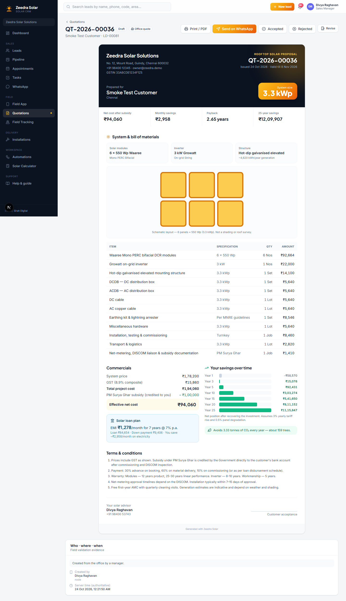

If a price needs to change later, open the quotation and click **Revise**. The original is kept exactly as it was (handy if you already reviewed its location check), and the new version carries the same quote number with a revision mark. A **Version history** list shows every revision.

---

## Field Tracking

A live map of your field sales reps: where they are, how many check-ins they have done today, and how trustworthy their quotations are.

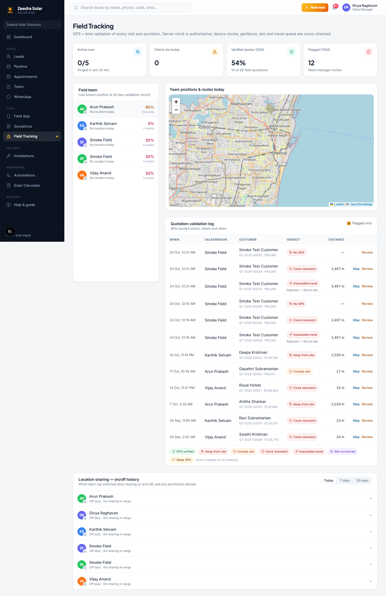

Use this to notice a rep who has gone quiet, or to dig into why a particular quote got flagged.

---

## Installations

Every deal your team has won becomes a project here, tracked from booking through to subsidy credit.

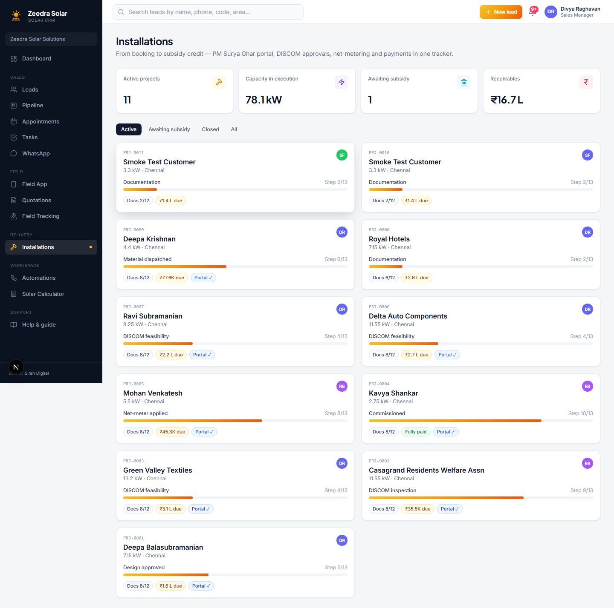

Click a project to see its execution stages and document checklist. You can also set who is responsible for each stage of the installation process, so handoffs between the sales team and the installer are clear.

---

## Automations

Your sales playbook on autopilot, written as "WHEN this happens, IF these conditions are true, THEN do this" rules.

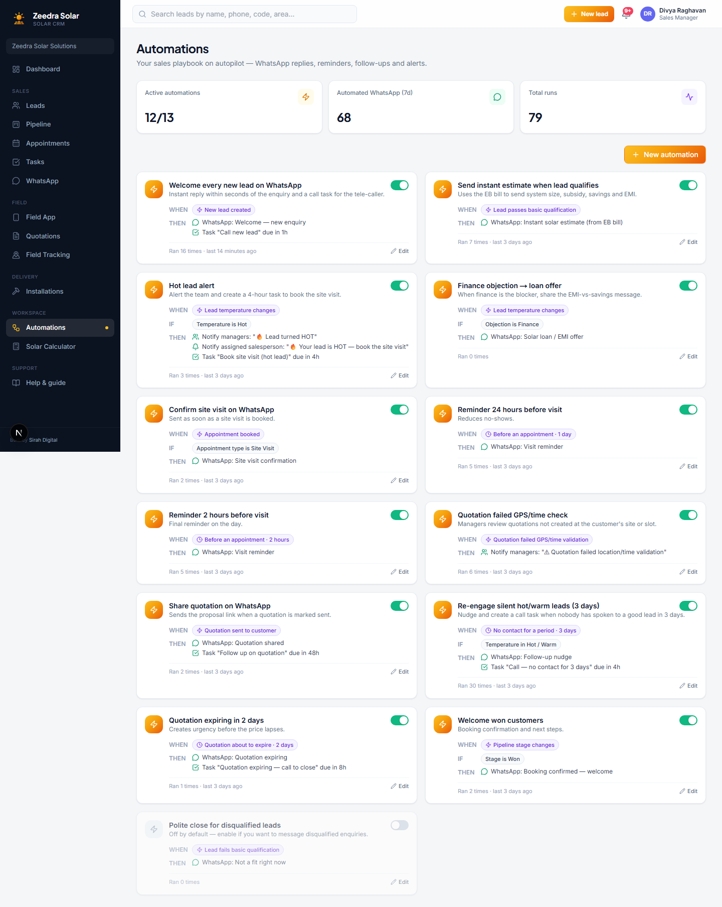

For example: WHEN a hot lead has had no contact for two days, THEN notify you. Turn any rule on or off with its switch, or click it to see or change the conditions and actions.

---

## Solar Calculator

A quick calculator for use on a call, without needing a lead on file yet. Enter a monthly electricity bill and instantly see the recommended system size, subsidy, savings and EMI options.

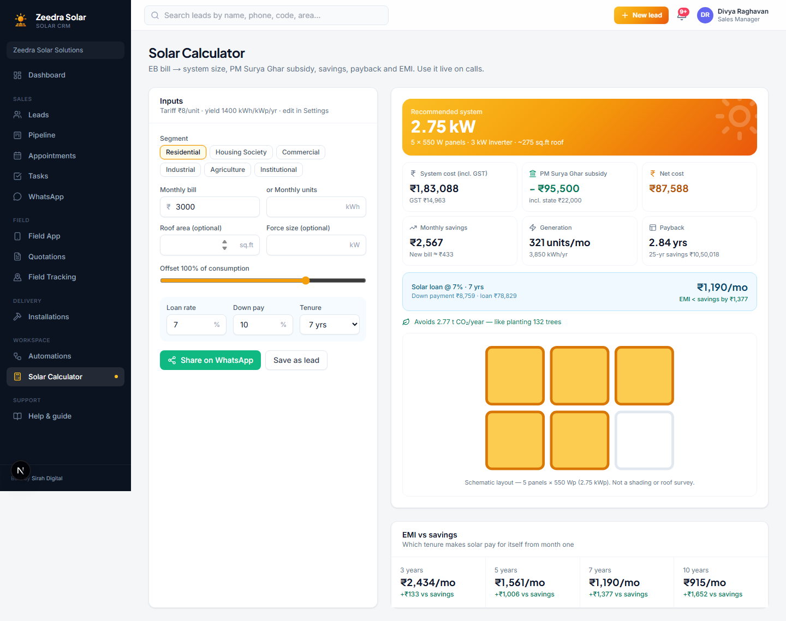

---

## My profile

Settings is not in your sidebar, since pricing, team and integrations are managed by the Owner and Admin. Your own profile is still always available from the person icon in the top right corner.

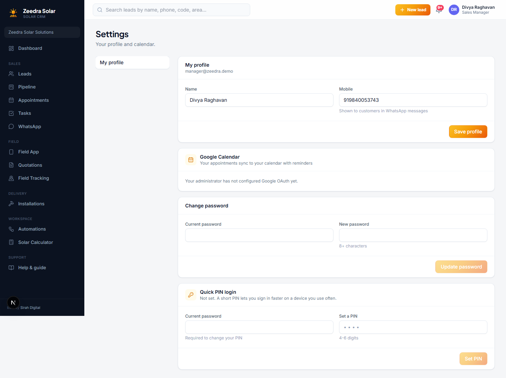

Here you can update your details, connect your personal Google Calendar so your appointments sync automatically, and change your password. You can also set a **Quick PIN login** so you can sign in faster on a device you use often, from the sign-in page click **Use a quick PIN instead**.

---

That covers everything you can do as Sales Manager. If you ever need a reminder while you work, the **Help & guide** page inside the app has the same content, filtered to whatever you are signed in as.
