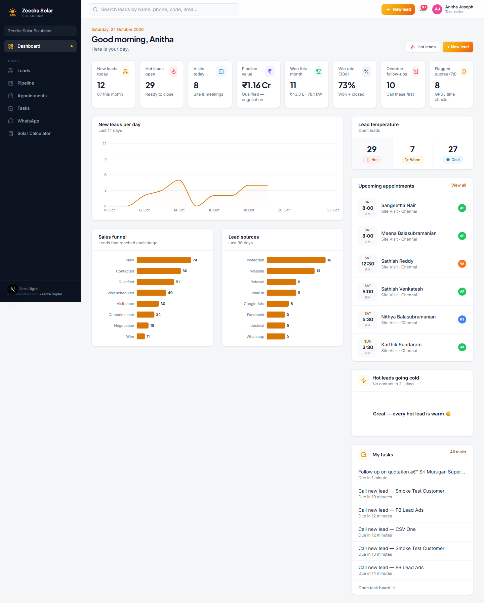
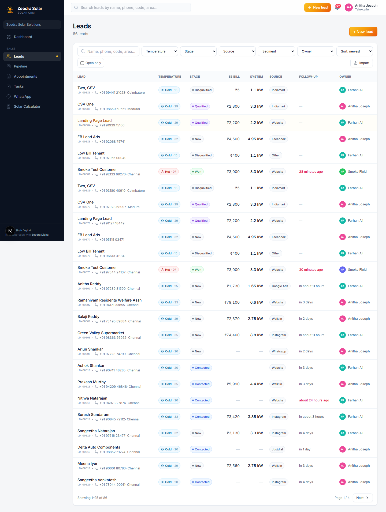
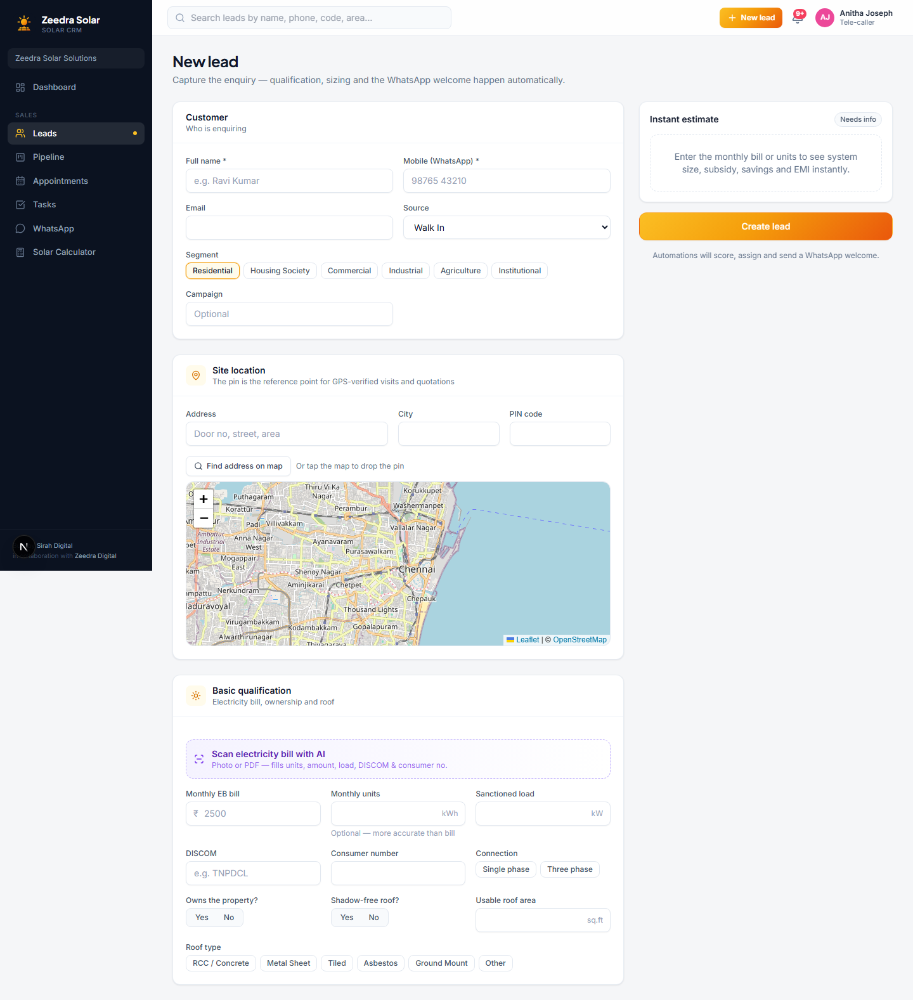
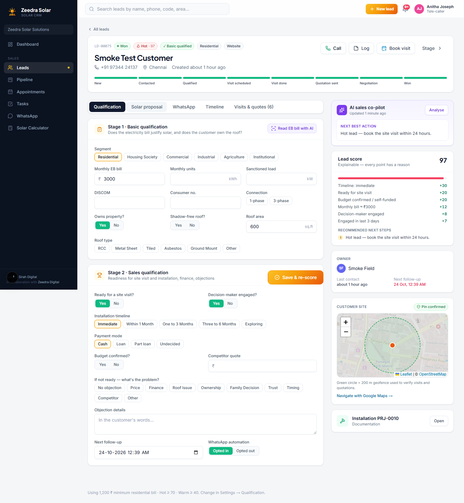
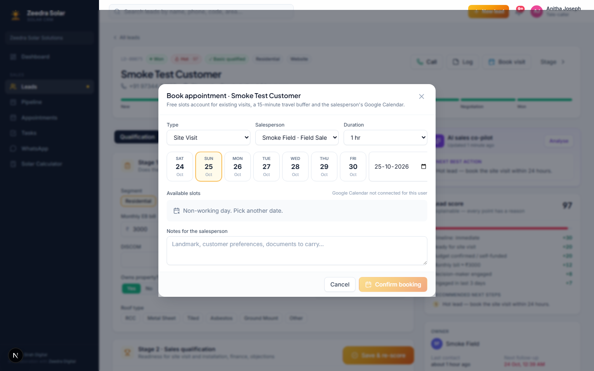
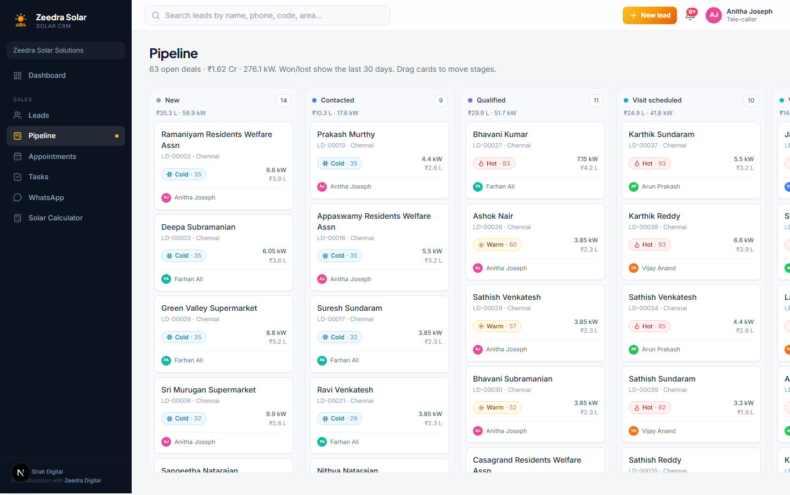
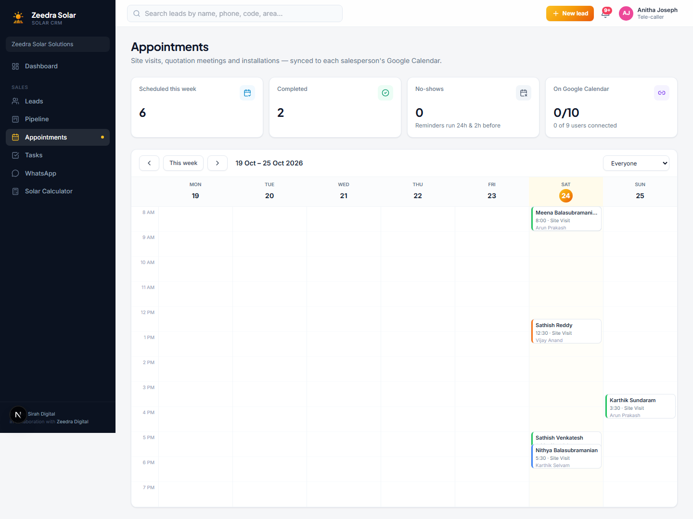
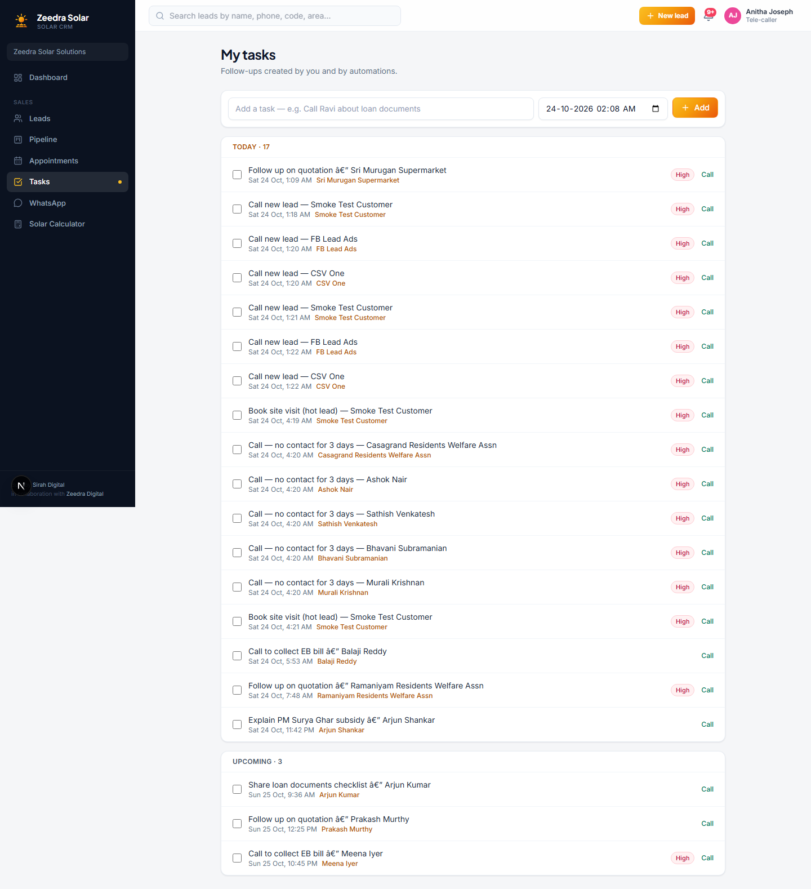
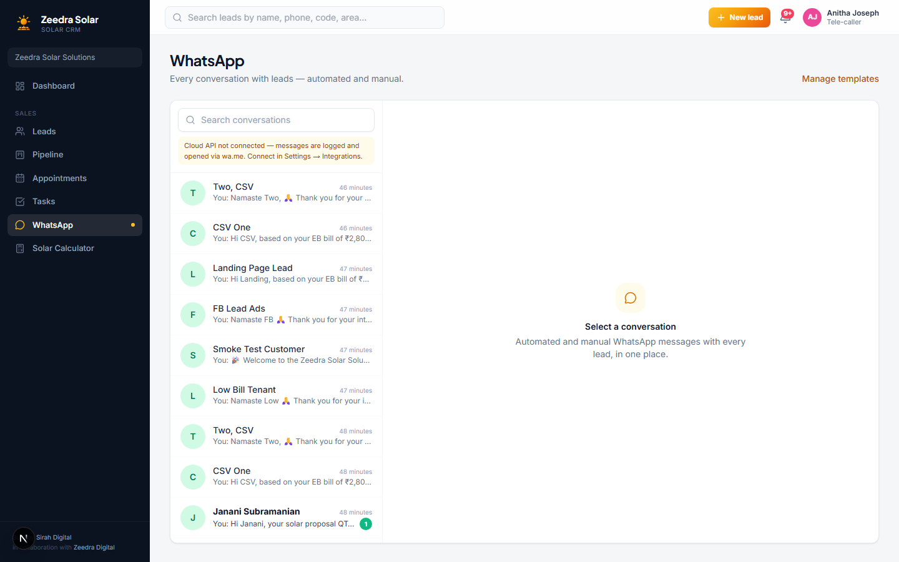
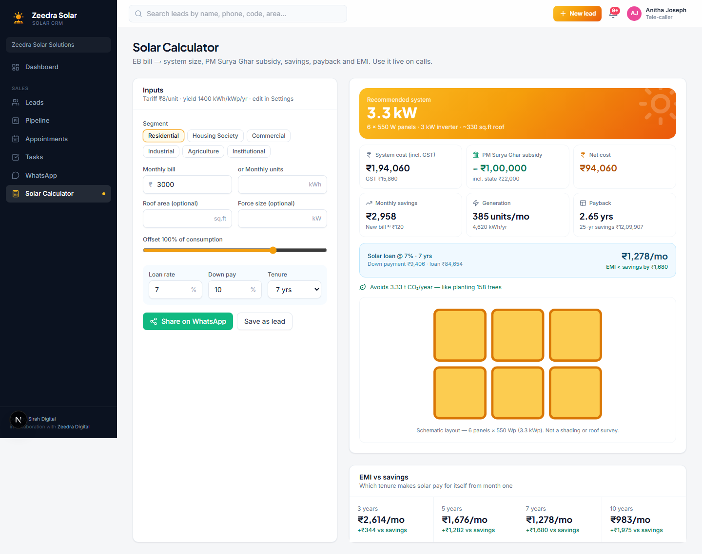

# Zeedra Solar CRM: Tele-caller Guide

This guide is for a Tele-caller. Your job is to pick up new leads quickly, qualify them over the phone, and book a site visit for a field sales rep once a customer is ready. You only see leads assigned to you.

If you only need a quick refresher while you work, open **Help & guide** from the left sidebar inside the app.

## Contents

1. [Signing in](#signing-in)
2. [Dashboard](#dashboard)
3. [Leads](#leads)
4. [Booking a visit](#booking-a-visit)
5. [Pipeline](#pipeline)
6. [Appointments](#appointments)
7. [Tasks](#tasks)
8. [WhatsApp](#whatsapp)
9. [Solar Calculator](#solar-calculator)

---

## Signing in

Go to the sign-in page and enter your email and password. Click **Sign in**.

### Your typical day

1. Start on the Dashboard, then open **Leads** and sort by score to call the hottest ones first.
2. Open a lead, fill in the Qualification tab as you talk to the customer, and save.
3. When a customer is ready for a site visit, click **Book visit**.
4. Check **Tasks** for any follow-up calls due today.

---

## Dashboard

The Dashboard shows your day at a glance: new leads, hot leads still open, visits scheduled, and anything overdue.

Click a stat tile, such as **Overdue follow-ups**, to jump straight to that list. Your **Upcoming appointments**, **Hot leads going cold** and **My tasks** cards on the right are a good place to start each morning.

---

## Leads

Every lead assigned to you lands here. You will not see leads assigned to other people.

Use the search box and filters to find a lead, or sort by score to call the hottest leads first. Click a lead's name to open it.

### Adding a lead by hand

If a customer calls in directly, click **+ New lead** to add them yourself.

Fill in their name, phone number, and whatever you learn about their electricity bill and site. Click **Create lead** when done. It is automatically assigned to you and scored right away.

### Qualifying a lead

Open a lead to see its workspace. The **Qualification** tab is where you record what the customer tells you: electricity bill, whether they own the property, roof type, how soon they want to install, budget, and any objections.

Fill it in as you talk, and click **Save & re-score** at the end of the call. The lead's score and temperature (Hot, Warm or Cold) update right away, so the next person who looks at it knows exactly where things stand.

The **Timeline** tab keeps a record of every call and note automatically, so if someone else ever needs to pick up this lead, they can see the full history.

---

## Booking a visit

Once a customer is ready, click **Book visit** in the lead header. Pick the visit type and a time slot.

Available slots are worked out automatically based on the field sales rep's working hours and travel time. Click **Confirm booking** to finish. The customer and the field rep are notified.

---

## Pipeline

A visual board of every open deal you are working, grouped by stage.

Use this to get a quick sense of how many leads you have at each stage of the sales process.

---

## Appointments

Your calendar of booked visits.

You only see your own appointments here, not the rest of the team's.

---

## Tasks

Your follow-up to-do list. Most tasks are created automatically, for example "call back in 2 days", but you can also add one yourself from a lead's Timeline tab.

Check this every day so no follow-up call slips through.

---

## WhatsApp

A single inbox for every WhatsApp conversation with your leads, automated and manual.

Click a conversation to open it and reply. Use saved templates for common replies instead of typing them out each time.

---

## Solar Calculator

A quick calculator you can use live on a call. Enter a customer's monthly electricity bill and instantly see the recommended system size, subsidy, savings and EMI options, useful for giving a customer a rough number before a full site visit is booked.

---

That covers everything you can do as a Tele-caller. If you ever need a reminder while you work, the **Help & guide** page inside the app has the same content.
